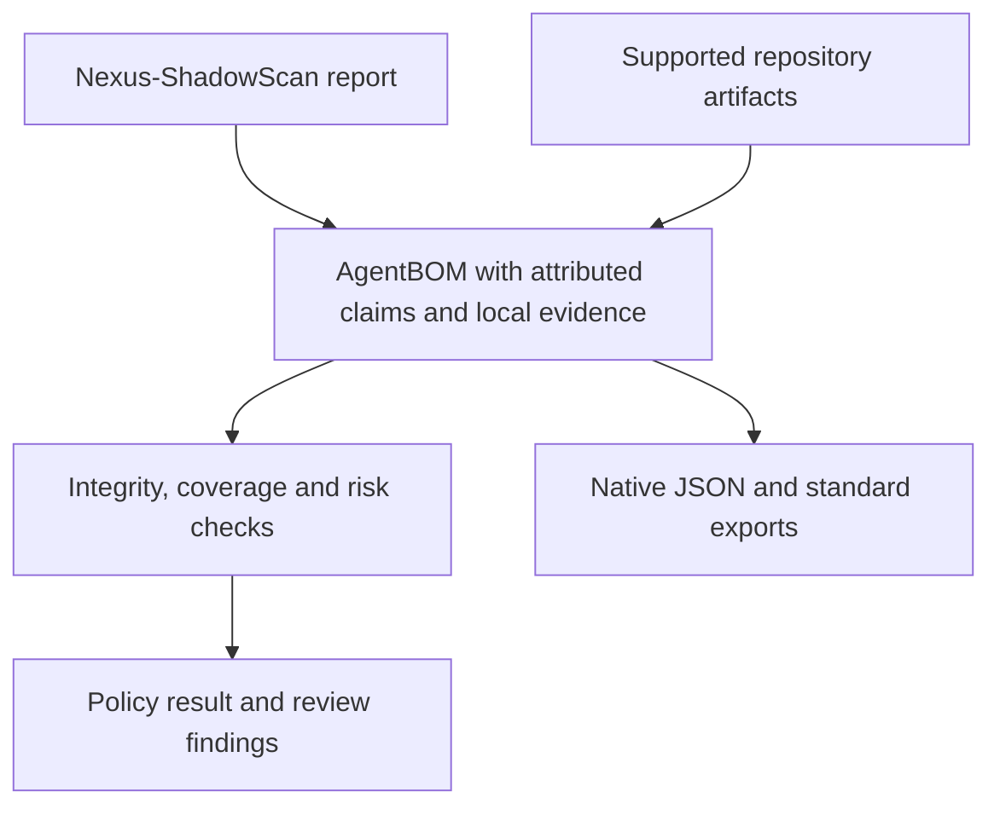

# Nexus SymBiote

[](https://github.com/Hunzee-VC/Nexus-Symbiote/actions/workflows/ci.yml)
[](https://github.com/Hunzee-VC/Nexus-Symbiote/actions/workflows/codeql.yml)
[](https://github.com/Hunzee-VC/Nexus-Symbiote/actions/workflows/ci.yml)
[](https://github.com/Hunzee-VC/Nexus-Symbiote/blob/main/LICENSE)

**Agent Bill of Materials: inventory, integrity evidence, policy checks and standard exports for AI agent supply chains.**

Nexus SymBiote is an alpha toolkit for creating and reviewing an Agent Bill of Materials (AgentBOM). It inventories supported MCP configurations, model artifacts, prompts and skills, retrieval settings, A2A cards, IDE configurations and package declarations. It checks integrity and coverage, scores findings under policy, compares snapshots, and exports reviewable BOMs.

[Nexus-ShadowScan](https://github.com/Hunzee-VC/Nexus-ShadowScan) is the primary multi-surface discovery engine. SymBiote consumes its reports and adds local artifact and supply-chain verification. Imported discovery remains a source claim; it does not establish deployment, effective access or authorization.

**A successful scan is an inventory result.** It does not establish that a model is benign, that a tool backend obeys its description, or that every agent action was mediated. Read the [security model](https://github.com/Hunzee-VC/Nexus-Symbiote/blob/main/docs/security-model.md) and [security policy](https://github.com/Hunzee-VC/Nexus-Symbiote/blob/main/SECURITY.md) before using results in an approval process.

## Install from reviewed source

The distribution and command are `nexus-symbiote`; the Python import package is `nexus_symbiote`. Python 3.11 or later is required. Confined file operations and pinned stdio launchers require supported POSIX primitives. The configured hosted matrix targets Ubuntu with Python 3.11–3.13; macOS and Windows are not qualified by that matrix.

Until a published release's ownership, source revision and provenance have been verified, install from a reviewed checkout. Replace `REVIEWED_COMMIT_SHA` with the immutable revision you reviewed:

```bash
git clone https://github.com/Hunzee-VC/Nexus-Symbiote.git
cd Nexus-Symbiote
git checkout --detach REVIEWED_COMMIT_SHA
python -m venv .venv
. .venv/bin/activate
python -m pip install --require-hashes --only-binary=:all: -r requirements-action.lock
python -m pip install --no-deps --no-build-isolation .
nexus-symbiote --version
```

**Hash-pinned proof (v0.1.0+):** Once published, verify a release the same way:

```bash
python -m pip install --require-hashes --only-binary=:all: -r https://github.com/Hunzee-VC/Nexus-Symbiote/releases/download/v0.1.0/requirements-action.lock
# or from the release assets after verifying the checksums and provenance
```

The core runtime/build lock excludes optional signing and independent consumer libraries. Source extras are `.[sigstore]`, `.[cyclonedx]` and `.[all]`. For the locked development and integration environment, use [CONTRIBUTING.md](https://github.com/Hunzee-VC/Nexus-Symbiote/blob/main/CONTRIBUTING.md) or `make install-locked` from the reviewed checkout. Publication and trusted-publisher configuration follow the separate [release procedure](https://github.com/Hunzee-VC/Nexus-Symbiote/blob/main/docs/releasing.md).

## Quick start

```bash
# Inspect external discovery without treating the partial import as approval
nexus-symbiote import-shadowscan shadowscan-report.json -o imported-agentbom.json --report-only

# Collect supported local evidence using built-in policy for an untrusted checkout
nexus-symbiote scan /path/to/agent-project --no-project-policy -o agentbom.json

# Check completeness and integrity against the project
nexus-symbiote validate agentbom.json --project /path/to/agent-project --no-project-policy

# Apply the risk gate
nexus-symbiote risk agentbom.json --threshold 50 --no-project-policy

# Fail CI when snapshot comparison reports a security alert
nexus-symbiote diff reviewed.json agentbom.json --fail-on-alert
```

Inspect the exit status and the inventory's coverage, exclusions and failures. A command may write evidence and still return a failing gate. Standalone imports require a new output path and retain partial coverage; `--report-only` is an explicit inspection mode. For trusted local projects, standalone `scan`, `validate` and `risk` load project policy by default. Pass `--no-project-policy` when the scanned checkout must not choose your verification policy.

## Show the collectors

```bash
# From a reviewed checkout — scan the examples/ fixture
nexus-symbiote scan examples --no-project-policy --report-only -o demo-agentbom.json
nexus-symbiote summary demo-agentbom.json
```

The collectors and their coverage semantics are described under [How it works](#how-it-works).

## Why Nexus SymBiote

Agent composition spans several kinds of evidence: package references, model bytes, tool descriptors, instructions, discovery reports and deployment claims. Those records are useful together only when their subjects, sources, assurance and limits remain clear.

| Review question | Supported evidence |
| --- | --- |
| What is declared in this project? | Supported local configurations, artifacts and package manifests, plus imported discovery claims |
| What changed since review? | Component, capability, endpoint, integrity and dependency drift |
| Do the bytes match the expected subject? | Confined file hashes, versioned tool fingerprints and optional signer-policy checks |
| What remains unknown? | Failed or excluded collection, unmapped inputs, unobserved runtime and authorization surfaces |
| Can this evidence pass a policy gate? | Explicit completeness, integrity and risk decisions under caller-selected policy |

These checks cover supported inputs and mediated adapters. They do not establish complete enterprise discovery, benign model behavior or enforcement of calls that bypass the adapter.

## How it works



The eight built-in collector names are `shadowscan`, `mcp`, `model`, `prompt`, `rag`, `registry`, `a2a` and `ide_agents`. Use `--scanner` to request a subset explicitly; omitted collectors remain unknown. A completed search can find no matching files, while unsupported declarations and failed reads remain coverage gaps.

Collection is static by default and does not execute project modules, model loaders, hooks or MCP launch commands. Configuration presence does not prove that a server is running or that its live tool definitions match the declaration. `verify-live` is a separate explicit execution operation requiring an independently pinned launcher policy and external isolation. `discover-mcp` is an explicit HTTPS observation operation. Neither command calls tools.

Project validation compares static MCP records and configured tool fingerprints with fresh local evidence. A structure binding detects added or removed arguments, environment variables and tools. With `NEXUS_SYMBIOTE_SOURCE_BINDING_KEY` set, a keyed binding also detects same-version package swaps and changed argument, environment and endpoint values, without exporting anything a secret could be guessed from. Legacy snapshots without this binding need recollection; see [source reconciliation and migration](https://github.com/Hunzee-VC/Nexus-Symbiote/blob/main/docs/verification-source-binding.md).

## Key capabilities and limits

| Capability | Evidence and limitation |
| --- | --- |
| ShadowScan integration | Exact source-report digest, mapped components and supported declared edges, with unmapped indexes and projection limits; no automatic producer authentication or trust upgrade |
| MCP and tools | Scoped client/server references and supported source declarations; runtime descriptors and backend behavior need separate evidence |
| Model integrity | Whole-file hashes, bounded format inspection, SafeTensors metadata fingerprints and optional Sigstore checks; a format, header fingerprint or signature does not prove benignness |
| Instructions and skills | Source-bound artifacts and suspicious-content findings; detection is limited to supported files and patterns |
| Retrieval and registries | Declared configuration, package identities and lineage references; presence does not establish actual installation or retrieval ACL enforcement |
| A2A and IDE declarations | Agent Cards, host settings and extension declarations; supplier labels are not proof of endpoint identity, execution or signature validity |
| Runtime contracts | Ed25519-signed snapshots, approvals and trust status bound to authenticated context in a reference adapter; deployments must prevent bypass and protect state |
| Impact analysis | Potential graph reachability through recorded relationships, not proof that an exploit executed |
| GitHub Action | One collected inventory, caller-owned gates and optional SARIF upload; disabled or skipped gates are visible policy choices |

MCP references include the relative configuration path and declared name. Recollect and review legacy snapshots that used name-only identities. Python source declaration collection has bounded application-file coverage and reports unresolved or dynamic registrations as gaps. See [TypeScript inventory](https://github.com/Hunzee-VC/Nexus-Symbiote/blob/main/docs/typescript-inventory.md), [ShadowScan integration](https://github.com/Hunzee-VC/Nexus-Symbiote/blob/main/docs/shadowscan-integration.md) and [runtime assurance](https://github.com/Hunzee-VC/Nexus-Symbiote/blob/main/docs/runtime-assurance.md) for the exact supported contracts.

## Commands and exit codes

| Command | Purpose |
| --- | --- |
| `scan` | Collect supported repository evidence and emit an AgentBOM |
| `import-shadowscan` | Project an external discovery report with conservative assurance |
| `validate` | Check graph, completeness and integrity under policy |
| `risk` | Score findings and apply the risk gate |
| `diff` | Compare snapshots; use `--fail-on-alert` to fail on security alerts |
| `summary` | Print an inventory summary |
| `blast-radius` | Inspect potential impact through recorded graph relationships |
| `baseline` | Create an unsigned candidate after collection and risk gates pass; review and authenticate it separately |
| `vex` | Export schema-validated inventory findings as `in_triage` |
| `advisories` | Explicitly query OSV for supported exact declared package identities |
| `verify-artifact` | Check selected local bytes against a trusted digest and optional signer policy |
| `verify-discovery` | Check report bytes/projection; optionally verify its producer under an external signer policy |
| `verify-live` | Observe independently pinned MCP launchers without calling tools |
| `discover-mcp` | Observe an explicitly allowed HTTPS MCP origin without calling tools |
| `init` | Create local policy configuration |
| `runtime keygen` | Generate Ed25519 keys |
| `runtime sign` | Sign a supported runtime contract |
| `runtime verify` | Verify a signed contract under supplied trust constraints |

| Exit code | Meaning |
| --- | --- |
| `0` | The command completed according to its selected mode; informational commands, report-only output and skipped gates do not establish approval |
| `1` | A gate failed, verification failed, or another command error occurred; `diff` alerts fail only with `--fail-on-alert` |
| `2` | CLI usage error, such as invalid arguments |

## Export formats

```bash
nexus-symbiote scan . -f json -o agentbom.json
nexus-symbiote scan . -f cyclonedx -o agentbom.cdx.json
nexus-symbiote scan . -f spdx -o agentbom.spdx.json
nexus-symbiote scan . -f sarif -o results.sarif
```

Native JSON retains the supported agent-specific model. CycloneDX 1.7 and SPDX 3.0.1 exports use supported standard structures and a digest-bound native extension. Consumers must retain that extension to recover full native semantics and inspect the selected-field loss report. A digest detects changes; it does not authenticate the producer. SPDX identities are scoped to each inventory revision.

SARIF contains reviewable findings rather than an admission decision. VEX is available through `vex` and does not assert exploitability. Schema validity alone establishes neither semantic equivalence nor complete collection. Standalone ShadowScan imports support native JSON, CycloneDX and SPDX, not SARIF.

## GitHub Action

Use a reviewed immutable SymBiote commit in the consuming repository. The checkout action is also pinned:

```yaml
name: Agent inventory
on: [push, pull_request]
permissions:
  contents: read
jobs:
  inventory:
    runs-on: ubuntu-latest
    steps:
      - uses: actions/checkout@d23441a48e516b6c34aea4fa41551a30e30af803 # v6
        with:
          persist-credentials: false
      - uses: Hunzee-VC/Nexus-Symbiote@<reviewed-40-character-commit-sha>
        with:
          scan-path: .
          output-file: agentbom.json
          validate: 'true'
          risk-check: 'true'
          risk-threshold: '50'
          sarif-upload: 'false'
```

The Action installs its reviewed source and derives exports and findings from one native inventory. It ignores policy files supplied by the scanned checkout. Inputs are passed as data; collection failures fail the Action even when later validation is disabled. A risk threshold of `0` disables the Action's risk gate. Disabling `validate` or `risk-check` is not evidence that verification passed.

Enable SARIF upload only when repository code scanning and the event's permissions support it, adding `security-events: write` to the job. Fork PRs may have restricted tokens; retained evidence is the fallback. Treat Action source as executable code and do not use `pull_request_target` to run an untrusted PR checkout with deployment credentials. See [action.yml](https://github.com/Hunzee-VC/Nexus-Symbiote/blob/main/action.yml) for inputs and outputs.

## Data handling and safety

Inventories can expose infrastructure, permissions, source references and instruction fingerprints. Restrict evidence access and retention. Static collection reduces secret capture, but consumers must review artifacts before sharing them. Keep credentials, private BOMs and customer data out of public issues.

Use independent expected digests and signer/issuer policies. A signature or registry label does not establish content safety. Runtime integrations govern only calls actually mediated by their adapter; surrounding identity, network and sandbox controls are deployment responsibilities.

IDE permission records describe collected project declarations. Claude's `permissions.defaultMode` and broad tool allowances are retained, while user/managed policy, workspace trust, deny/ask precedence and session flags remain outside effective-authorization verification. Scanner failures emit application-owned diagnostic codes; raw exception text and invalid model configuration values are omitted from failure reports.

## Documentation

| Topic | Link |
| --- | --- |
| Security model and reporting | [Security model](https://github.com/Hunzee-VC/Nexus-Symbiote/blob/main/docs/security-model.md) · [SECURITY.md](https://github.com/Hunzee-VC/Nexus-Symbiote/blob/main/SECURITY.md) |
| Runtime and deployment evidence | [Runtime assurance](https://github.com/Hunzee-VC/Nexus-Symbiote/blob/main/docs/runtime-assurance.md) · [Deployment evidence](https://github.com/Hunzee-VC/Nexus-Symbiote/blob/main/docs/deployment-evidence.md) |
| Discovery and source inventory | [ShadowScan integration](https://github.com/Hunzee-VC/Nexus-Symbiote/blob/main/docs/shadowscan-integration.md) · [TypeScript inventory](https://github.com/Hunzee-VC/Nexus-Symbiote/blob/main/docs/typescript-inventory.md) |
| Development and controls | [CONTRIBUTING.md](https://github.com/Hunzee-VC/Nexus-Symbiote/blob/main/CONTRIBUTING.md) · [Repository controls](https://github.com/Hunzee-VC/Nexus-Symbiote/blob/main/docs/repository-controls.md) |
| Releases and changes | [Releasing](https://github.com/Hunzee-VC/Nexus-Symbiote/blob/main/docs/releasing.md) · [CHANGELOG.md](https://github.com/Hunzee-VC/Nexus-Symbiote/blob/main/CHANGELOG.md) · [ROADMAP.md](https://github.com/Hunzee-VC/Nexus-Symbiote/blob/main/ROADMAP.md) |
| Historical reconciliation | [Closed-PR audit](https://github.com/Hunzee-VC/Nexus-Symbiote/blob/main/docs/audits/closed-pr-review-2026-11-02.md) |

## Benchmarks

```bash
python scripts/check_security_regressions.py --out security-regressions.json
python benchmarks/inventory/run_inventory.py
```

The [security corpus](https://github.com/Hunzee-VC/Nexus-Symbiote/blob/main/benchmarks/README.md) and [inventory corpus](https://github.com/Hunzee-VC/Nexus-Symbiote/blob/main/benchmarks/inventory/README.md) contain inspectable fixtures, labels and provenance. The security runner records corpus and source digests, unknowns, denominators, elapsed time and Python allocation measurements. Credential-redaction and coverage controls remain separate from detection counts. These finite regression cases establish no representative field accuracy, complete collection or percentile ranking.

## Project status

Nexus SymBiote is **alpha**. APIs, formats and policy semantics may change, and no production SLA or long-term support commitment is offered. Workflows define verification gates, but their presence does not establish that hosted jobs ran or that branch protection is active. The observed hosted verification and enforcement blockers are tracked in [issue #74](https://github.com/Hunzee-VC/Nexus-Symbiote/issues/74); see the dated [audit](https://github.com/Hunzee-VC/Nexus-Symbiote/blob/main/docs/audits/closed-pr-review-2026-11-02.md) for local evidence and limits.

Package publication requires an explicit maintainer request, successful exact-source verification and the configured publication controls. This README does not establish package-index ownership, active environment protection or a verified release. Canonical repository is now under the Hunzee-VC organization.

## Community and contributing

| I want to… | Go to |
| --- | --- |
| Report a security issue | [SECURITY.md](https://github.com/Hunzee-VC/Nexus-Symbiote/blob/main/SECURITY.md) |
| Report a bug or request a feature | [GitHub Issues](https://github.com/Hunzee-VC/Nexus-Symbiote/issues) |
| Contribute code | [CONTRIBUTING.md](https://github.com/Hunzee-VC/Nexus-Symbiote/blob/main/CONTRIBUTING.md) |
| Understand governance and ownership | [GOVERNANCE.md](https://github.com/Hunzee-VC/Nexus-Symbiote/blob/main/GOVERNANCE.md) · [MAINTAINERS.md](https://github.com/Hunzee-VC/Nexus-Symbiote/blob/main/MAINTAINERS.md) |
| Find support guidance | [SUPPORT.md](https://github.com/Hunzee-VC/Nexus-Symbiote/blob/main/SUPPORT.md) |

## License

[MIT](https://github.com/Hunzee-VC/Nexus-Symbiote/blob/main/LICENSE) — Copyright (c) 2026 AISecNomad.
