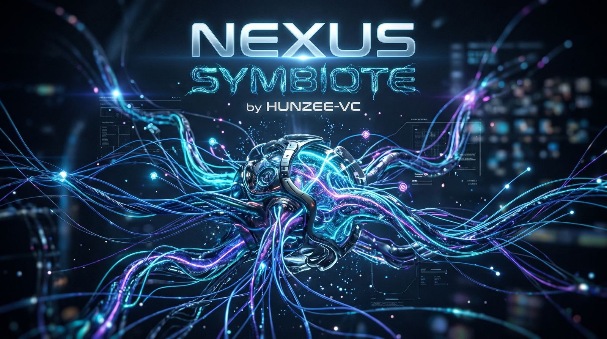

<p align="center">
  
</p>

<h1 align="center">Nexus SymBiote</h1>

<p align="center">
  <strong>Know what your AI agents are built from. Gate them on evidence. Catch drift before it ships.</strong>
</p>

<p align="center">
  <a href="https://github.com/Hunzee-VC/Nexus-Symbiote/actions/workflows/ci.yml"></a>
  <a href="https://github.com/Hunzee-VC/Nexus-Symbiote/actions/workflows/codeql.yml"></a>
  <a href="https://github.com/Hunzee-VC/Nexus-Symbiote/blob/main/pyproject.toml"></a>
  <a href="https://github.com/Hunzee-VC/Nexus-Symbiote/blob/main/LICENSE"></a>
  <a href="#project-status"></a>
  <a href="#what-it-produces"></a>
</p>

<p align="center">
  <a href="#quick-start"><b>Quick start</b></a> ·
  <a href="#why"><b>Why</b></a> ·
  <a href="#what"><b>What</b></a> ·
  <a href="#how"><b>How</b></a> ·
  <a href="https://github.com/Hunzee-VC/Nexus-Symbiote/blob/main/docs/README.md"><b>Docs</b></a> ·
  <a href="#project-status"><b>Status</b></a>
</p>

Nexus SymBiote generates an **Agent Bill of Materials (AgentBOM)** — an evidence-backed inventory of the MCP servers, models, instructions, retrieval sources, A2A cards, IDE settings and container images an AI agent is assembled from. It reads a project **without running it**, flags supply-chain risk, fails CI on drift in what it records, and exports to CycloneDX 1.7, SPDX 3.0.1, SARIF and VEX.

```bash
nexus-symbiote scan ./my-agent --no-project-policy -o agentbom.json    # inventory, offline
nexus-symbiote risk agentbom.json --no-project-policy --threshold 50   # gate on risk
nexus-symbiote diff reviewed.json agentbom.json --fail-on-alert        # gate on drift
```

> **Alpha.** Interfaces, formats and policy semantics may change. Install the published release only after verifying its build attestation, or install a reviewed commit from source; see [Install a verified release](#install-a-verified-release) and [Install from reviewed source](#install-from-reviewed-source). This release has [known detection gaps](https://github.com/Hunzee-VC/Nexus-Symbiote/blob/main/docs/known-limitations.md): what the collectors do not record, no gate or `diff` can alert on.

## Quick start

### Install from reviewed source

Requires git and Python 3.11 to 3.14 on Linux. Install exactly the commit you reviewed, with the hash-locked runtime:

```bash
git clone https://github.com/Hunzee-VC/Nexus-Symbiote.git
cd Nexus-Symbiote
git checkout --detach REVIEWED_COMMIT_SHA
python3 -m venv .venv && . .venv/bin/activate
python -m pip install --require-hashes --only-binary=:all: -r requirements-action.lock
python -m pip install --no-deps --no-build-isolation .
nexus-symbiote --version
```

Replace `REVIEWED_COMMIT_SHA` with the full commit you reviewed; right after the clone, `git rev-parse HEAD` prints the latest commit on `main`. Optional extras: `.[sigstore]` for Sigstore verification, which the lock already includes; `.[cyclonedx]` installs the CycloneDX Python library, which the test suite uses to cross-check exports (the tool itself does not import it); `.[all]` for both. For development: `make install-locked` (see [CONTRIBUTING.md](https://github.com/Hunzee-VC/Nexus-Symbiote/blob/main/CONTRIBUTING.md)).

### Try it in 60 seconds

From the checkout, inventory the bundled [demo agent](https://github.com/Hunzee-VC/Nexus-Symbiote/tree/main/examples/demo-agent), a small synthetic support assistant. Nothing is executed and no network is used:

```bash
nexus-symbiote scan examples/demo-agent -o demo.aibom.json
nexus-symbiote summary demo.aibom.json
nexus-symbiote risk demo.aibom.json --no-project-policy
nexus-symbiote validate demo.aibom.json --project examples/demo-agent --no-project-policy
```

The scan records 11 components across 9 types and ten findings (risk score 37, below the default fail threshold of 50):

| Severity | Component | Finding |
| --- | --- | --- |
| high | `memory` MCP server | Unpinned package reference (`@latest`) |
| high | `models/intent-classifier.safetensors` | No verified, artifact-bound signature |
| high | `ollama/ollama:latest` container image | No immutable digest pin |
| medium | `notes` and `memory` MCP servers | stdio transport: each runs as a local process |
| medium | `product-notes` retrieval source | No declared content-filtering control |
| low | `notes` and `tickets` MCP servers, `support-research-assistant` A2A card, `product-notes` retrieval source | Values not bound without a source-binding key: a launch argument, endpoint and source URI paths |

`risk` passes its gate. `validate` exits 1 on purpose: completeness passes, but the model's integrity stays unknown because no signer policy was supplied. An inventory can be complete and still not be approvable.

To approve the model, pin its digest in a signer policy you own, kept outside the scanned project. Here the digest comes from the checkout, which only shows the mechanism; in real use, take it from a source you trust:

```bash
digest="$(sha256sum examples/demo-agent/models/intent-classifier.safetensors | cut -d' ' -f1)"
printf '{"version": 2, "artifacts": [{"kind": "digest-pin", "expected_sha256": "sha256:%s",
  "artifact_path": "models/intent-classifier.safetensors"}]}\n' "$digest" > signers.json
nexus-symbiote validate demo.aibom.json --project examples/demo-agent --no-project-policy \
  --signature-policy signers.json
```

`validate` now exits 0. The four low findings go away when `NEXUS_SYMBIOTE_SOURCE_BINDING_KEY` is set, as in [Gate drift in CI](#gate-drift-in-ci). The [examples walkthrough](https://github.com/Hunzee-VC/Nexus-Symbiote/blob/main/examples/README.md) adds drift detection, exports and a ShadowScan import, all offline.

## Why

**AI agents are assembled from parts you did not write, and most of those parts never appear in a software bill of materials.**

An agent's behavior depends on its configuration as much as its code — MCP servers, model weights, instruction files, retrieval sources, agent endpoints, IDE permissions — and each can change without a code review. Package SBOMs don't cover these. The [OWASP Top 10 for Agentic Applications](https://genai.owasp.org/) lists agentic supply-chain vulnerabilities (ASI04) among the top risks.

| Risk | What it looks like | What Nexus SymBiote records |
| --- | --- | --- |
| Floating dependencies | MCP server at `@latest`; image without a digest | Unpinned-version and missing-digest findings |
| Tool rug pulls | A tool's description or schema changes after review | Fingerprints of the tools a [live observation](https://github.com/Hunzee-VC/Nexus-Symbiote/blob/main/docs/offline-and-live-modes.md#detect-drift-on-a-remote-mcp-server) records; a changed definition is a critical drift alert. A static scan records tools declared in source by name and file digest |
| Endpoint repointing | An MCP or A2A endpoint moves to another host | Critical or high drift alerts. An MCP endpoint with `${...}` expansion or an ambiguous host is a gap; a same-host path change needs the [binding key](https://github.com/Hunzee-VC/Nexus-Symbiote/blob/main/docs/verification-source-binding.md) |
| Scope widening | An A2A card's OAuth scope goes from `read:only` to `admin` | High drift alert on the card's [capabilities](https://github.com/Hunzee-VC/Nexus-Symbiote/blob/main/docs/verification-source-binding.md#a2a-agent-cards-and-client-entries) |
| Executable model files | Pickle checkpoint; a `.safetensors` file that is not one | Format classification without loading; SafeTensors header validation |
| Unsigned weights | Model file with no artifact-bound signature | `UNKNOWN` integrity until your [signer policy](https://github.com/Hunzee-VC/Nexus-Symbiote/blob/main/docs/model-integrity.md#operator-signature-policy) verifies it |
| Hidden instructions | Bidi or zero-width characters in `CLAUDE.md`; text in an HTML comment | [Hidden-character](https://github.com/Hunzee-VC/Nexus-Symbiote/blob/main/docs/security-model.md#known-false-positive-and-false-negative-classes) findings in every text file the `prompt` collector reads, and hidden-comment findings in its Markdown and suffix-less files |
| Over-broad permissions | Claude Code in `bypassPermissions` mode, granted `Bash(*)`, or given a hook command | Permission and hook findings; a digest of each JSON settings file, so any change to one is a drift alert |
| Credential exposure | Tokens in MCP env blocks or connection strings | Variable names, never values; known secret patterns redacted |

Every row has limits, listed by surface in the [known limitations](https://github.com/Hunzee-VC/Nexus-Symbiote/blob/main/docs/known-limitations.md). The trust model, design principles and offline-by-default enforcement are in the [security model](https://github.com/Hunzee-VC/Nexus-Symbiote/blob/main/docs/security-model.md).

## What

**An AgentBOM: one evidence-backed inventory of an agent, with gates, drift checks and standard exports.**

### How it works

```text
             ┌──────────────────────────────────────────────┐
  agent      │ 8 static collectors: nothing is executed     │
  project ──>│ mcp · model · prompt · rag · registry        │
 (read-only) │ a2a · ide_agents · shadowscan                │
             └──────────────────────┬───────────────────────┘
                                    v
             ┌──────────────────────────────────────────────┐
             │ AgentBOM (native JSON)                       │
             │ components · relationships · findings        │
             │ coverage, gaps and assurance for every claim │
             └──────┬───────────────┬───────────────┬───────┘
                    v               v               v
             validate · risk       diff          exports
             gates, exit 0/1   drift alerts   CycloneDX · SPDX
                                               SARIF · VEX
```

1. **Collect.** Each collector reads its surfaces through confined, size-bounded file reads and returns components, findings and coverage status.
2. **Assemble.** Results merge into one AgentBOM. Every claim keeps its assurance level: declared, observed or verified.
3. **Gate.** `validate` checks completeness and integrity; `risk` scores findings against your policy. Gaps the collectors report fail closed; surfaces they do not support are not reported.
4. **Compare.** `diff` compares two snapshots semantically and rates each change.
5. **Export.** Standard formats are generated from the same collection, so every export describes the same evidence.

### What it inventories

Eight built-in collectors read the project's configuration and artifacts, and the `mcp`, `rag` and `a2a` collectors also search its source code for SDK and library references. Nothing they read is executed, imported or loaded. Select a subset with `--scanner`; collectors you leave out are recorded as unknown, not clean.

| Surface | Collector | Records |
| --- | --- | --- |
| MCP client configuration, launcher resolver settings, server source | `mcp` | Clients, servers, launchers, package identities and pins, transports, endpoints, tool fingerprints |
| Model weights, with their configuration, tokenizer and custom code | `model` | SHA-256 of every weight file, serialization safety, SafeTensors structure, signature status |
| Instruction, rule, skill, command and subagent files | `prompt` | Content digests; hidden-character and hidden-comment findings |
| RAG configuration, root `.env` key names, vector-store imports | `rag` | Retrieval sources: store, index and embedding identities, URI origins, control states |
| Package manifests and lockfiles, Dockerfiles, Compose files | `registry` | Packages and images in the [AI package catalog](https://github.com/Hunzee-VC/Nexus-Symbiote/blob/main/docs/registry-collector.md#ai-package-catalog), pins, lockfile integrity, image digests |
| A2A agent cards, client configuration, SDK references | `a2a` | Endpoint and interface origins, security schemes and scopes, card signatures (recorded, not verified) |
| Settings of Claude Code, Codex, Cursor, Gemini CLI, Windsurf, Cline, Copilot and others | `ide_agents` | Configured agents, permission modes, blanket grants, hooks, a digest of each JSON settings file |
| [Nexus-ShadowScan](https://github.com/Hunzee-VC/Nexus-ShadowScan) reports | `shadowscan` | Imported discovery claims, kept separate from local evidence; CI can require a signed report |

The [collector reference](#collector-reference) lists every path each collector reads, the coding-agent settings that raise findings, and the registry collector's gaps in requirements files and Dockerfiles. The [registry collector](https://github.com/Hunzee-VC/Nexus-Symbiote/blob/main/docs/registry-collector.md) and [model integrity](https://github.com/Hunzee-VC/Nexus-Symbiote/blob/main/docs/model-integrity.md) pages describe those two collectors in full. An optional [`agent.yaml` manifest](https://github.com/Hunzee-VC/Nexus-Symbiote/blob/main/docs/agent-manifest.md) at the project root names the agent and declares further instruction files and models.

### What it checks

| Command | What it answers |
| --- | --- |
| `validate` | Did every collector finish without reporting a gap? Do hashes, signatures and source bindings still match? |
| `risk` | What are the findings, and does the score or worst severity cross your [policy](https://github.com/Hunzee-VC/Nexus-Symbiote/blob/main/docs/policy-reference.md)? |
| `diff` | What changed in the recorded inventory since the reviewed snapshot, and how much does each [change](https://github.com/Hunzee-VC/Nexus-Symbiote/blob/main/docs/drift-gate.md#what-the-alerts-mean) matter? |
| `verify-artifact`, `verify-discovery` | Do these bytes match a trusted digest, Sigstore identity or ShadowScan report? |
| `blast-radius` | Which agents and components are associated with a compromised component? |
| `runtime keygen/sign/verify/digest/key-id/register` | Are signed [runtime contracts](https://github.com/Hunzee-VC/Nexus-Symbiote/blob/main/docs/runtime-contract-reference.md) valid, current and canonical? `register` retires older snapshots; only the gateway checks revocation and approval bindings |
| `discover-mcp`, `verify-live`, `advisories` | What does a running server actually serve? Do exact versions have known advisories? *(live mode)* |

Each check sees only what the collectors record: surfaces they do not support are neither gaps nor compared ([known limitations](https://github.com/Hunzee-VC/Nexus-Symbiote/blob/main/docs/known-limitations.md)). The [CLI reference](https://github.com/Hunzee-VC/Nexus-Symbiote/blob/main/docs/cli-reference.md) documents every command and option.

### What it produces

| Output | How to get it | Use it for |
| --- | --- | --- |
| Native AgentBOM JSON | `scan` (default) | Full-fidelity record; defined by the [AgentBOM schema](https://github.com/Hunzee-VC/Nexus-Symbiote/blob/main/schemas/README.md) |
| CycloneDX 1.7 | `scan -f cyclonedx` | SBOM tooling; validated against the pinned official schema |
| SPDX 3.0.1 | `scan -f spdx` | SPDX tooling; validated against the pinned official schema |
| SARIF 2.1.0 | `scan -f sarif` | GitHub code scanning and other SARIF viewers |
| CycloneDX VEX | `vex` | Findings marked `in_triage`, with no exploitability claim |

Standard exports embed the native inventory in a digest-bound extension; keep it to recover full semantics. Without it, a consumer never sees a conditional edge as an unconditional relationship, and sees coverage as `incomplete` or `unknown`, never `complete`. [Standard exports](https://github.com/Hunzee-VC/Nexus-Symbiote/blob/main/docs/standard-exports.md) maps every field, including SARIF rules and what VEX can express. Exports written by builds before 0.1.0 may need to be regenerated; see [fingerprint migration](https://github.com/Hunzee-VC/Nexus-Symbiote/blob/main/docs/fingerprint-migration.md).

### What a scan does not prove

A scan is an inventory, not a verdict. It does not show that a model is benign, that a tool's backend matches its description, or that every agent action was mediated. Read [what results do and do not establish](https://github.com/Hunzee-VC/Nexus-Symbiote/blob/main/docs/security-model.md#what-results-do-and-do-not-establish) before using results in an approval process. Treat exported BOMs as sensitive.

## How

**Install a verified release, inventory your agent, then let CI hold the line.**

### Install a verified release

Requires Python 3.11 to 3.14 on Linux, git, curl and the [GitHub CLI](https://cli.github.com/) signed in with `gh auth login`. Releases are built from `main` by the [release workflow](https://github.com/Hunzee-VC/Nexus-Symbiote/blob/main/.github/workflows/release.yml) and published to PyPI through OIDC trusted publishing with build attestations. The block resolves the `v0.1.0` tag to its commit, downloads the exact wheel, verifies its attestation against that commit, and only then installs the hash-locked runtime from the same commit and the wheel, without resolving anything else:

```bash
(
  set -euo pipefail
  python3 -m venv --clear .venv
  commit="$(git ls-remote https://github.com/Hunzee-VC/Nexus-Symbiote.git 'refs/tags/v0.1.0^{}' | cut -f1)"
  test -n "$commit" || { echo "tag v0.1.0 not found" >&2; exit 1; }
  .venv/bin/python -m pip download --no-deps --only-binary=:all: nexus-symbiote==0.1.0 -d dist
  gh attestation verify dist/nexus_symbiote-0.1.0-py3-none-any.whl --repo Hunzee-VC/Nexus-Symbiote \
    --signer-workflow Hunzee-VC/Nexus-Symbiote/.github/workflows/release.yml \
    --source-ref refs/heads/main --source-digest "$commit" --deny-self-hosted-runners
  curl -fsSL -o requirements-action.lock \
    "https://raw.githubusercontent.com/Hunzee-VC/Nexus-Symbiote/$commit/requirements-action.lock"
  .venv/bin/python -m pip install --require-hashes --only-binary=:all: -r requirements-action.lock
  .venv/bin/python -m pip install --no-deps dist/nexus_symbiote-0.1.0-py3-none-any.whl
  .venv/bin/nexus-symbiote --version
)
```

Then activate the environment with `. .venv/bin/activate`. The wheel does not include the demo agent; run [the demo](#try-it-in-60-seconds) from a checkout.

- **Paste the block as one unit, unchanged.** The subshell rebuilds `.venv` and stops at the first failing command, such as a missing or signed-out `gh` or a missing tag. Placing it before `&&` or `||` makes bash ignore its `set -e`, and running the lines one at a time loses these checks.
- **What the block establishes.** Nothing is installed unless the release workflow attested these exact wheel bytes for the commit the tag points at, and the lock file comes from that commit. The version check runs last, inside `.venv`, so an earlier install on your `PATH` cannot stand in for the verified wheel.
- **What it cannot establish.** Another commit that differs only in its lock file can build the same wheel, and candidate runs are attested without approval, so only the [release-tag ruleset](https://github.com/Hunzee-VC/Nexus-Symbiote/blob/main/docs/repository-controls.md#operator-prerequisites) keeps the tag on the published commit. The `v0.1.0` tag was created after publication, and whether the ruleset was applied first was not recorded ([release record](https://github.com/Hunzee-VC/Nexus-Symbiote/blob/main/docs/releasing.md#release-record)).

[Releasing](https://github.com/Hunzee-VC/Nexus-Symbiote/blob/main/docs/releasing.md#what-the-pipeline-guarantees) describes what the attestation does and does not establish.

### Scan your own agent

```bash
nexus-symbiote scan /path/to/agent --no-project-policy -o agentbom.json
nexus-symbiote validate agentbom.json --project /path/to/agent --no-project-policy
nexus-symbiote risk agentbom.json --project /path/to/agent --no-project-policy --threshold 50
```

- `--no-project-policy` stops a `.nexus-symbiote.yaml` in a checkout that is not yours from choosing your gates.
- With `--project`, `validate` and `risk` collect fresh evidence and fail when the BOM disagrees with it.
- A scan that reaches one of the [collection limits](https://github.com/Hunzee-VC/Nexus-Symbiote/blob/main/docs/collection-limits.md) fails and names it. Raise it with `--limit NAME=VALUE` before the command, or with `NEXUS_SYMBIOTE_LIMITS`, and use the same limits for a later `validate --project` or `risk --project`, which collect the project again:

```bash
nexus-symbiote --limit entries=200000 --limit model-bytes=128GiB scan /path/to/agent --no-project-policy -o agentbom.json
```

The [public-agent tutorial](https://github.com/Hunzee-VC/Nexus-Symbiote/blob/main/docs/tutorials/scanning-a-public-agent.md) walks through a real repository end to end.

### Gate drift in CI

Approve a baseline once, on the protected branch, then compare every pull request with it. The baseline is unsigned, so read it from a place the pull request cannot change, and take both snapshots the same way:

```bash
# One secret of 32 or more characters, the same for the baseline and every later scan.
export NEXUS_SYMBIOTE_SOURCE_BINDING_KEY="$AGENTBOM_BINDING_KEY"

# On the protected branch, through a reviewed pull request: approve the baseline.
mkdir -p .nexus-symbiote
nexus-symbiote baseline . --no-project-policy -o .nexus-symbiote/reviewed.json

# In the pull-request job: read the baseline from the base commit, never from the pull request.
git show "$BASE_SHA:.nexus-symbiote/reviewed.json" > "$RUNNER_TEMP/reviewed.json"
nexus-symbiote scan . --no-project-policy -o "$RUNNER_TEMP/agentbom.json"
nexus-symbiote diff "$RUNNER_TEMP/reviewed.json" "$RUNNER_TEMP/agentbom.json" --fail-on-alert
```

- **What fails.** `--fail-on-alert` fails on any change to the recorded inventory rated medium or higher, including a removed component and a coverage regression. An added source file that changes no component does not alert.
- **Same policy, same key.** `--no-project-policy` keeps a policy file in the checkout from narrowing either snapshot. A different binding key, or a key on one side only, changes every binding and alerts.
- **Without the key, values pass.** The inventory then records MCP launch arguments, environment values and endpoint paths only as redacted positions, so a served directory widened from `./notes` to `/`, a changed environment value or a same-host endpoint path passes, and so does an [A2A or RAG](https://github.com/Hunzee-VC/Nexus-Symbiote/blob/main/docs/known-limitations.md#a2a-and-rag) path changed on the same host that keeps its depth. Each such record carries a low `completeness` finding that names the key. See [source binding](https://github.com/Hunzee-VC/Nexus-Symbiote/blob/main/docs/verification-source-binding.md).
- **Paths are project-relative**, so a baseline recorded in one checkout compares cleanly with a scan of another. Inventories written by 0.1.0 hold absolute paths: record the baseline again after upgrading.

Run the comparison in a job the pull request cannot edit; see [Protect the gate](#protect-the-gate). The gate cannot alert on what the collectors do not record; the [known limitations](https://github.com/Hunzee-VC/Nexus-Symbiote/blob/main/docs/known-limitations.md) list what that is. [Gate drift in CI](https://github.com/Hunzee-VC/Nexus-Symbiote/blob/main/docs/drift-gate.md) explains where the baseline must come from and what each alert means.

### GitHub Action

Pin the Action to a reviewed 40-character commit:

```yaml
name: Agent inventory
on: [push, pull_request]
permissions:
  contents: read
jobs:
  inventory:
    runs-on: ubuntu-latest
    timeout-minutes: 15
    steps:
      - uses: actions/checkout@3d3c42e5aac5ba805825da76410c181273ba90b1 # v7.0.1
        with:
          persist-credentials: false
      - uses: Hunzee-VC/Nexus-Symbiote@<reviewed-40-character-commit-sha>
        with:
          scan-path: .
          output-file: agentbom.json
          validate: 'true'
          risk-check: 'true'
          risk-threshold: '50'
          sarif-upload: 'false'
```

The Action installs its own hash-locked runtime, including Sigstore verification, in a private virtual environment that it keeps off the job's `PATH`, without changing the job's default Python. It ignores policy in the scanned checkout and fails on collection errors. Text from the checkout reaches the job log only inside a `stop-commands` block, neutralized, so it cannot set outputs or create annotations. Keep a job timeout like the one above: hostile input can keep a scan running until the job times out.

- **Every gate states its result.** The `result` output is `passed` or `failed`, and `gates` is a JSON object with the state of each gate (`collection`, `completeness`, `integrity`, `risk`, `drift`): `passed`, `failed`, `skipped` (switched off by an input) or `not-run`. Every gate an input switches off is printed as a warning.
- **Integrity needs verified evidence.** With `validate: 'true'`, integrity passes only when at least one artifact hash or signature verifies and no component's evidence is unknown, so a repository in which nothing verifies, such as an empty checkout or one with only an MCP configuration, fails. A model counts only as a SafeTensors file whose every weight file is signed or digest-pinned in a [signer policy](https://github.com/Hunzee-VC/Nexus-Symbiote/blob/main/docs/model-integrity.md#operator-signature-policy) you own, so a repository that contains a model fails unless every model meets such a policy. `validate-integrity: 'false'` checks completeness without integrity, for a repository whose models cannot be signed yet; `validate: 'false'` skips both.
- **The risk gate.** `risk-threshold: '0'` removes only the aggregate score threshold; critical findings, unverified SafeTensors, incomplete coverage and missing evidence still fail it. With `validate: 'true'`, risk reconciles the inventory against `scan-path` with the same signer policy, so a reconciliation failure fails it too, without a score. `risk-check: 'false'` skips it.
- **Unverified discovery evidence.** A ShadowScan report in the repository is unsigned discovery evidence unless the signer policy verifies its producer, and the completeness and risk gates fail on it. `allow-unsigned-discovery: 'true'` accepts it explicitly, with a warning.
- **The drift gate.** `reviewed-baseline` adds it: the absolute path of a reviewed AgentBOM outside the workspace, written from a trusted source like the signer policy below, which the Action compares with `diff --fail-on-alert`. The `drift-passed` and `drift-alerts` outputs report the result. The Action collects with the step's `NEXUS_SYMBIOTE_SOURCE_BINDING_KEY`, if any, so record the baseline with the same key, or with none.
- **Limits.** `limits` raises [collection limits](https://github.com/Hunzee-VC/Nexus-Symbiote/blob/main/docs/collection-limits.md#set-a-limit), for example `'entries=200000,model-total-bytes=512GiB'`. The job's own `NEXUS_SYMBIOTE_LIMITS` is ignored.
- **SARIF.** Set `sarif-upload: 'true'` and add `security-events: write` to upload SARIF. The upload is skipped, with a warning, for an inventory that merges imported ShadowScan discovery. Give each Action step in one workflow run its own `artifact-name` and `sarif-category`.

Inputs and outputs are in [action.yml](https://github.com/Hunzee-VC/Nexus-Symbiote/blob/main/action.yml). Write the signer policy outside the workspace from a trusted source, such as a repository or organization variable, never from the checked-out code:

```yaml
      - name: Write the signer policy
        env:
          SIGNER_POLICY: ${{ vars.NEXUS_SYMBIOTE_SIGNER_POLICY }}
        run: printf '%s' "$SIGNER_POLICY" > "$RUNNER_TEMP/signers.json"
      - uses: Hunzee-VC/Nexus-Symbiote@<reviewed-40-character-commit-sha>
        with:
          scan-path: .
          signature-policy: ${{ runner.temp }}/signers.json
```

The Action refuses a policy inside the workspace, a path that passes through a symlink (including a symlinked `RUNNER_TEMP`), or a hard link, passes one snapshot of it to collection, validation and the risk gate, and reports its SHA-256, as `sha256:<hex>`, in the `signature-policy-digest` output. It verifies signatures offline against the Sigstore trust root shipped in its hash-locked `sigstore` package, never a cache on the runner.

#### Protect the gate

On `pull_request`, GitHub runs the workflow file of the pull request's merge commit, so the pull request under review can change these inputs, switch a gate off or delete the step, and pass. Make the gate one the pull request cannot edit. In an organization, require the workflow through an organization ruleset (*Require workflows to pass before merging*), which pins it to a file and ref the pull request cannot change. Otherwise, run it on `pull_request_target`, which takes the workflow from the base branch, with read-only permissions, no secrets and the pull request's head checked out as data:

```yaml
name: Agent inventory gate
on: pull_request_target
permissions:
  contents: read
jobs:
  inventory:
    runs-on: ubuntu-latest
    timeout-minutes: 15
    steps:
      - uses: actions/checkout@3d3c42e5aac5ba805825da76410c181273ba90b1 # v7.0.1
        with:
          ref: ${{ github.event.pull_request.head.sha }}
          persist-credentials: false
      - name: Stage the reviewed baseline from the base branch
        env:
          GH_TOKEN: ${{ github.token }}
          BASE_SHA: ${{ github.event.pull_request.base.sha }}
        run: >-
          gh api -H 'Accept: application/vnd.github.raw'
          "repos/$GITHUB_REPOSITORY/contents/.nexus-symbiote/reviewed.json?ref=$BASE_SHA"
          > "$RUNNER_TEMP/reviewed.json"
      - uses: Hunzee-VC/Nexus-Symbiote@<reviewed-40-character-commit-sha>
        with:
          scan-path: .
          reviewed-baseline: ${{ runner.temp }}/reviewed.json
```

This is safe only because no step runs code from the checkout: the Action reads it as data. Add no build, install or test step and no secret to such a job, and require code-owner review for `.github/`. Without a secret, the job collects without `NEXUS_SYMBIOTE_SOURCE_BINDING_KEY`, so approve the baseline it stages without the key too: a keyed baseline would alert on every binding, and changes to values that only the key binds pass this gate.

### Pre-commit hooks

The repository also ships [pre-commit hooks](https://github.com/Hunzee-VC/Nexus-Symbiote/blob/main/docs/cli-reference.md#pre-commit-hooks) (`nexus-symbiote-scan` and `nexus-symbiote-risk`), which apply the scan gate with the built-in policy and write nothing into the tree. pre-commit installs their dependencies from PyPI without hashes, so pin `rev` to a reviewed commit, and treat the hooks as a convenience for your own tree, not a control.

### Policy and live mode

Every command is offline by default. Only `discover-mcp`, `advisories` and `verify-live` reach the network, and only in live mode (`--live` before the command, or `NEXUS_SYMBIOTE_MODE=live`); see [offline and live modes](https://github.com/Hunzee-VC/Nexus-Symbiote/blob/main/docs/offline-and-live-modes.md).

A project policy, `.nexus-symbiote.yaml`, is read only from the project you scan or name with `--project`, never from a parent directory or from where an inventory file is saved. Generate one for a trusted project with `nexus-symbiote init`, or pass `--no-project-policy` when the checkout is not yours. The [policy reference](https://github.com/Hunzee-VC/Nexus-Symbiote/blob/main/docs/policy-reference.md) lists every setting.

### Exit codes

| Exit | Meaning |
| --- | --- |
| `0` | The command completed and every requested gate passed |
| `1` | A gate or check failed (risk, integrity, drift, incomplete collection), an input could not be read, or an internal error occurred |
| `2` | Usage error, including an invalid collection limit, a binding key shorter than 32 characters, and a live command run in offline mode (`advisories --dry-run` contacts nothing and runs in either mode) |

The [CLI reference](https://github.com/Hunzee-VC/Nexus-Symbiote/blob/main/docs/cli-reference.md#exit-codes) says when each command exits 1.

## Collector reference

### What each collector reads

Every path is relative to the project root. Each collector also bounds what it reads; see [collection limits](https://github.com/Hunzee-VC/Nexus-Symbiote/blob/main/docs/collection-limits.md).

| Collector | Reads |
| --- | --- |
| `mcp` | At the root: `.mcp.json`, `mcp.json`, `claude_desktop_config.json`, `.claude/mcp.json`, `.cursor/mcp.json`, `.vscode/mcp.json`, `.gemini/settings.json`, `.roo/mcp.json`, `.kiro/settings/mcp.json`, `.amazonq/mcp.json`, `.windsurf/mcp.json`, `.cline/mcp.json` and `.codex/config.toml`. At any depth: files named `.mcp.json`, `mcp.json`, `mcp-config.json`, `mcp_config.json`, `mcp-servers.json`, `claude_desktop_config.json` and `cline_mcp_settings.json`. The root resolver settings that apply to launchers: `.npmrc`, `bunfig.toml`, `.yarnrc.yml`, `.yarnrc`, `.env.yarn`, `uv.toml` and `pyproject.toml`. Python, TypeScript and JavaScript source that names an MCP SDK or a supported agent framework |
| `model` | `.safetensors`, `.gguf`, `.ggml`, `.onnx`, Keras (`.h5`, `.hdf5`, `.keras`), `.tflite`, `.mlmodel`, `.pte`, `saved_model.pb` and pickle-family files ([full list](https://github.com/Hunzee-VC/Nexus-Symbiote/blob/main/docs/model-integrity.md#model-files-and-references)), with ONNX external data, SavedModel variables, shard indexes, configuration, tokenizer files, chat templates and declared custom code |
| `prompt` | At the root: `CLAUDE.md`, `.claude/CLAUDE.md`, `CLAUDE.local.md`, `AGENTS.md`, `AGENTS.override.md`, `.github/AGENTS.md`, `GEMINI.md`, `CODEX.md`, `codex.md`, `.codex/instructions.md`, `.github/copilot-instructions.md`, `.cursorrules`, `.clinerules` (a file or a directory), `.windsurfrules`, `system_prompt.md` and `system_prompt.txt`. At any depth: `CLAUDE.md` and `AGENTS.md`. Every file under `.claude/rules`, `.cursor/rules`, `.windsurf/rules`, `.roo/rules`, `.kiro/steering`, `.github/instructions`, `.github/prompts`, `.claude/output-styles`, `.claude/agents` and `.github/agents`, and under the skill and command directories `.claude/skills`, `.claude/commands`, `skills`, `.agents/skills`, `.github/skills`, `.cursor/skills`, `.gemini/skills`, `.cursor/commands` and `.gemini/commands`, including a skill's bundled scripts. Files that the root `CLAUDE.md`, `.claude/CLAUDE.md`, `CLAUDE.local.md` and `GEMINI.md`, or a `CLAUDE.md` at any depth, import with `@path` |
| `rag` | At any depth: `rag_config.json`, `rag_config.yaml`, `rag_config.yml`, `retrieval_config.json`, `vector_store_config.json`, `kb_config.json` and `knowledge_base.json`. At the root: `.env`, `.env.local` and `.env.example`, for key names only. Python files, for vector-store imports |
| `registry` | At the root only: `package.json` with one lockfile (`npm-shrinkwrap.json` or `package-lock.json`, `pnpm-lock.yaml` or `yarn.lock`); `requirements*.txt`; `pyproject.toml`, with `uv.lock` or `poetry.lock`; `Dockerfile`, `Dockerfile.agent` and `Containerfile`; and the Compose files and override files Compose reads by default. [What it reads](https://github.com/Hunzee-VC/Nexus-Symbiote/blob/main/docs/registry-collector.md#what-it-reads) gives the fields |
| `a2a` | `agent.json` and `agent-card.json` in any `.well-known` directory and in the root, and `a2a/agent.json`. At the root, client configuration in `a2a.json`, `a2a.yaml`, `a2a.yml` or `a2a_config.json`. Python files outside directories named `tests`, `test`, `dist`, `build`, `docs`, `benchmarks` or `examples`, for SDK references |
| `ide_agents` | Marker files and settings of Claude Code (also `.claude` settings in subdirectories, and plugin manifests), Codex (`.codex/config.toml`), Cursor (including `.cursor/hooks.json`), Gemini CLI (`.gemini/settings.json`), Windsurf, Cline, Copilot and others; `.vscode/extensions.json`, for recommended AI extensions |
| `shadowscan` | A report at `.shadowscan/report.json`, `shadowscan-report.json` or `shadowscan.json`; reports at more than one of them are a failure |

### Coding-agent settings

For Claude Code, `ide_agents` records the permission mode (`bypassPermissions` is a high finding, `acceptEdits` medium), blanket grants in its allow list, how many allow, ask and deny rules and hook handlers it declares, and findings for hook commands, `apiKeyHelper`, MCP auto-approval, plugins and additional directories. It does not record the rules or hook commands themselves. For Codex it records the approval and sandbox settings, for Cursor its hook commands, and for Cursor, Windsurf, Cline and Codex an `agent.permissionMode` key in their JSON settings. The MCP servers that Codex and Gemini CLI settings declare are inventoried by the `mcp` collector. [Instructions and IDE settings](https://github.com/Hunzee-VC/Nexus-Symbiote/blob/main/docs/known-limitations.md#instructions-and-ide-settings) lists what this leaves out.

### Registry gaps in requirements files and Dockerfiles

A gap makes the collector partial, which fails `scan`, `validate` and `risk` by default. The [registry collector](https://github.com/Hunzee-VC/Nexus-Symbiote/blob/main/docs/registry-collector.md#coverage-gaps) page lists every other gap and finding.

- **Requirements files** are read by pip 26.3's rules, without following includes, constraints files, editable installs or URL, VCS and path requirements. These are gaps: an include, constraints file or editable install that reaches beyond the root `requirements*.txt` files or the project itself; a URL, VCS, archive or path requirement without a package name, other than the project itself; an option pip 26.3 does not know, on an option line; and a `${NAME}` variable in a requirement's name or in an option line's option place. A declared encoding other than UTF-8 is a failure.
- **Recorded without a gap:** a `name @ URL` requirement, under its name and URL origin, or as written when the URL has no `//`, unless pip could read its text as a path in the project. Options after a requirement on the same line are not checked, except `-e` and `--hash`; `--hash` values are recorded. A variable inside an option's value is neither resolved nor reported.
- **Dockerfiles** are read as BuildKit reads them: the instruction word in any case, `--flag` words skipped, continued lines joined and trimmed, comment lines and heredoc bodies skipped, and `FROM` lines that name an earlier build stage left out. These are gaps: an `ARG` substitution, quotes or escapes in the image, a `FROM` line or heredoc that cannot be parsed, and an escape directive other than a backslash.

## Documentation

The [documentation hub](https://github.com/Hunzee-VC/Nexus-Symbiote/blob/main/docs/README.md) organizes every guide by Why, What and How. Start here:

| If you want to… | Read |
| --- | --- |
| See how the tool is put together and where untrusted input enters | [Architecture](https://github.com/Hunzee-VC/Nexus-Symbiote/blob/main/docs/architecture.md) |
| Know what the tool protects, from whom, and which control answers each threat | [Threat model](https://github.com/Hunzee-VC/Nexus-Symbiote/blob/main/docs/threat-model.md) |
| Understand the trust model | [Security model](https://github.com/Hunzee-VC/Nexus-Symbiote/blob/main/docs/security-model.md) |
| Know what is not recorded, compared or verified | [Known limitations](https://github.com/Hunzee-VC/Nexus-Symbiote/blob/main/docs/known-limitations.md) |
| Run the full offline demo | [Examples walkthrough](https://github.com/Hunzee-VC/Nexus-Symbiote/blob/main/examples/README.md) |
| Scan a real project end to end | [Scanning a public agent](https://github.com/Hunzee-VC/Nexus-Symbiote/blob/main/docs/tutorials/scanning-a-public-agent.md) |
| Look up a command, option or exit code | [CLI reference](https://github.com/Hunzee-VC/Nexus-Symbiote/blob/main/docs/cli-reference.md) |
| Write a project policy or suppress a finding | [Policy reference](https://github.com/Hunzee-VC/Nexus-Symbiote/blob/main/docs/policy-reference.md) |
| Raise a collection limit | [Collection limits](https://github.com/Hunzee-VC/Nexus-Symbiote/blob/main/docs/collection-limits.md) |
| Keep a drift baseline out of a pull request's reach | [Gate drift in CI](https://github.com/Hunzee-VC/Nexus-Symbiote/blob/main/docs/drift-gate.md) |
| Map exports to CycloneDX, SPDX, SARIF and VEX fields | [Standard exports](https://github.com/Hunzee-VC/Nexus-Symbiote/blob/main/docs/standard-exports.md) |
| Import Nexus-ShadowScan discovery | [ShadowScan integration](https://github.com/Hunzee-VC/Nexus-Symbiote/blob/main/docs/shadowscan-integration.md) |
| Mediate tool calls with signed contracts | [Runtime assurance](https://github.com/Hunzee-VC/Nexus-Symbiote/blob/main/docs/runtime-assurance.md) · [Runtime contract reference](https://github.com/Hunzee-VC/Nexus-Symbiote/blob/main/docs/runtime-contract-reference.md) |
| Release or verify a release | [Releasing](https://github.com/Hunzee-VC/Nexus-Symbiote/blob/main/docs/releasing.md) · [Repository controls](https://github.com/Hunzee-VC/Nexus-Symbiote/blob/main/docs/repository-controls.md) |

## Project status

Nexus SymBiote is **alpha** with a single maintainer: APIs, formats and policy semantics may change, and there is no SLA. Known detection gaps are listed in the [known limitations](https://github.com/Hunzee-VC/Nexus-Symbiote/blob/main/docs/known-limitations.md). CI, including CodeQL, runs on every push to `main` and every pull request that targets it. It tests the hash-locked dependency set on Python 3.11 to 3.14 and the declared dependency floors on Python 3.11; a weekly workflow tests the newest releases the declared ranges admit. A release is published only by the environment-gated [release workflow](https://github.com/Hunzee-VC/Nexus-Symbiote/blob/main/docs/releasing.md), after its preflight has confirmed branch protection and a successful `Verified CI` run for the exact commit. Planned work is tracked in the [roadmap](https://github.com/Hunzee-VC/Nexus-Symbiote/blob/main/ROADMAP.md) and changes are in the [changelog](https://github.com/Hunzee-VC/Nexus-Symbiote/blob/main/CHANGELOG.md).

[Nexus-ShadowScan](https://github.com/Hunzee-VC/Nexus-ShadowScan) is the companion discovery engine — it finds agents across many surfaces, and Nexus SymBiote turns its reports into AgentBOMs with local artifact and supply-chain verification.

## Security

Report vulnerabilities privately as described in [SECURITY.md](https://github.com/Hunzee-VC/Nexus-Symbiote/blob/main/SECURITY.md), never in a public issue.

## Contributing

Contributions are welcome — especially tested collector coverage, regression fixtures and documentation. See [CONTRIBUTING.md](https://github.com/Hunzee-VC/Nexus-Symbiote/blob/main/CONTRIBUTING.md) for setup and review contract, [GOVERNANCE.md](https://github.com/Hunzee-VC/Nexus-Symbiote/blob/main/GOVERNANCE.md) for decisions, and [SUPPORT.md](https://github.com/Hunzee-VC/Nexus-Symbiote/blob/main/SUPPORT.md) for troubleshooting. Please follow the [code of conduct](https://github.com/Hunzee-VC/Nexus-Symbiote/blob/main/CODE_OF_CONDUCT.md).

## Citation

If you use Nexus SymBiote in research or tooling, cite it with the metadata in [CITATION.cff](https://github.com/Hunzee-VC/Nexus-Symbiote/blob/main/CITATION.cff), or use **Cite this repository** on GitHub.

## License

[MIT](https://github.com/Hunzee-VC/Nexus-Symbiote/blob/main/LICENSE). Copyright (c) 2026 Emmanuel Dahunsi (AISecNomad). The vendored schemas under `src/nexus_symbiote/generators/schemas/vendor/` keep their upstream licenses: the CycloneDX schemas are Apache-2.0 ([license](https://github.com/Hunzee-VC/Nexus-Symbiote/blob/main/src/nexus_symbiote/generators/schemas/vendor/LICENSE-APACHE-2.0.txt)), and the SPDX 3.0.1 schema and context come from the SPDX Specification, which is Community-Spec-1.0 with CC-BY-3.0 for pre-existing portions ([license](https://github.com/Hunzee-VC/Nexus-Symbiote/blob/main/src/nexus_symbiote/generators/schemas/vendor/LICENSE-SPDX-3.0.1.txt)). The [notice](https://github.com/Hunzee-VC/Nexus-Symbiote/blob/main/src/nexus_symbiote/generators/schemas/vendor/NOTICE.txt) gives their sources, so the distribution's license expression is `MIT AND Apache-2.0 AND Community-Spec-1.0`.
