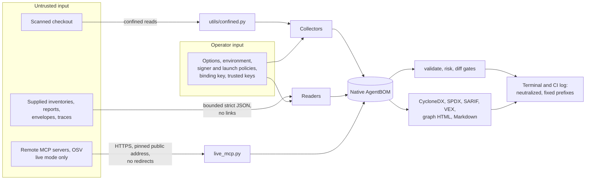

# Security audit of the whole repository, 2026-11-14

Target: `main` at `4aaf727` (version 0.2.0 in `pyproject.toml`; the newest published
release is 0.1.0 on `d8c54e4`). The audit read every source module, script, workflow,
configuration file and documentation page in the tree, ran the test suite, coverage and
the repository's own checks, and verified each finding against the code before
recording it. It was performed with Claude Code at the maintainer's request; no second
person has reviewed it. Treat every claim below as something to re-check against the
commit it names, as the [governance](../../GOVERNANCE.md) page asks of every review.

- [Verdict](#verdict)
- [Scope and method](#scope-and-method)
- [What the tool protects and from whom](#what-the-tool-protects-and-from-whom)
- [Findings](#findings)
- [Controls confirmed](#controls-confirmed)
- [Documentation accuracy](#documentation-accuracy)
- [Test suite](#test-suite)
- [Supply-chain posture](#supply-chain-posture)
- [What to do next](#what-to-do-next)
- [Residual risk and open questions](#residual-risk-and-open-questions)

## Verdict

**Ship with conditions.** No critical or high finding was verified. The controls the
documentation claims hold under adversarial input: the offline tripwire refuses every
socket, resolver and process path tried; the confined reader leaked nothing from a
hostile checkout built to escape it; output files are never written through a link;
model, lockfile and Markdown parsers fail closed on crafted input within their
bounds; the `graph` page escapes every inventory string; the drift gate alerts on every
in-place change tried; the release pipeline is pinned, hash-locked, attested and
verified before it publishes. The project's own documentation already names most of
the residual risk.

Four findings are rated medium. Two are defects fixed in the pull request that carries
this report, each with a regression test that failed before the fix:

1. A ShadowScan report behind a symbolic-linked `.shadowscan` directory bypassed the
   "more than one report" refusal and was imported as a complete observation, so a
   checkout could replace the report its pipeline wrote.
2. A Claude Code allow rule such as `Bash(sh:*)` approves any command but was recorded
   as a scoped grant, so a reviewer reading the inventory saw a narrowly permitted
   agent.

The other two are governance and release-process conditions that no code change can
close: a pull request still controls its own required check and no independent review
is enforced, and the verified-release install chain depends on a tag ruleset whose
application the project has not recorded. Both are documented by the project; both are
the first things to fix.

## Scope and method

| Surface | Read | How it was tested |
| --- | --- | --- |
| `src/nexus_symbiote/` (104 modules, 53,597 lines) | Every line | Static reading, 40 proof-of-concept scripts against the real functions, hostile fixture scans |
| `scripts/` (14), `action.yml`, `.github/` (6 workflows, config, templates), `pyproject.toml`, `Makefile`, three locks, `config/` | Every line | Checks run: `check_workflows.py`, `check_repository_hygiene.py`, `check_locks.py`, `check_security_regressions.py`, a build into a scratch directory, the live GitHub API for tags, releases, branches, workflow registrations and the open pull request |
| `docs/` (41 pages), `README.md`, `SECURITY.md`, `GOVERNANCE.md`, `CONTRIBUTING.md`, `CHANGELOG.md`, `ROADMAP.md`, `schemas/`, `examples/`, `benchmarks/` | Every line (the crosswalk and minimum-element catalog tables were read for structure and grepped for claims) | Every security claim checked against the code or a test; every documented command re-run |
| `tests/` (205 files, 76,624 lines), `tests/vectors/`, `tests/fixtures/` | Security-named tests line by line; the rest by name, assertion pattern and run | Full suite, coverage with per-module floors, skip accounting, socket-guard experiments |

The tree was split into seven read-through tracks (MCP collectors; model, registry,
RAG and prompt collectors; A2A, IDE, ShadowScan and tool-source collectors; core,
generators, validators, diff and graph; CLI, policy, attestation and trace; CI, packaging
and documentation; the test suite). The lead read the trust-boundary modules
(`modes.py`, `utils/confined.py`, `utils/files.py`, `utils/terminal.py`,
`utils/secrets.py`, `utils/crypto.py`, `core/hashing.py`, `runtime.py`,
`runtime_validation.py`, `limits.py`, `live/`, `scripts/run_action.py`,
`scripts/check_repository_controls.py`, every workflow and `tests/conftest.py`) in full,
and reproduced every finding below before including it. Findings marked *inferred* were
established by reading, not by running an exploit.

Everything read from the repository was treated as data. No file, comment, fixture or
document contains text directed at AI reviewers or tools; the only such phrases are
detection fixtures in `tests/` and `benchmarks/`.

## What the tool protects and from whom

The assets, adversaries and boundaries match the project's own
[threat model](../threat-model.md); this audit tested that model rather than
re-deriving it. In brief:

The property that matters most is the one the project states first: a wrong pass of a
gate. Every finding below was rated by whether it can produce one, then by what it costs
an attacker.

## Findings

Severity is the impact on this tool's gates and users; confidence is how surely the
finding was established. "Fixed here" means the pull request carrying this report
contains the change and a regression test that failed before it.

| ID | Severity | Confidence | Finding | Disposition |
| --- | --- | --- | --- | --- |
| M1 | Medium | High | A pull request controls its own required check and no review is enforced | Recommend |
| M2 | Medium | High | ShadowScan report selection bypassed by a symbolic-linked directory | Fixed here |
| M3 | Medium | High | Interpreter-prefixed Bash grants recorded as scoped | Fixed here |
| M4 | Medium | Medium | Verified-release chain rests on an unrecorded tag ruleset; candidates are attested without approval | Recommend |
| L1 | Low | High | Action forwards `NEXUS_SYMBIOTE_SIGSTORE_TRUST_ROOT` from the job environment | Recommend |
| L2 | Low | High | `trace-diff` passes tool and agent spans that name no identifier | Recommend |
| L3 | Low | High | Project-policy relaxations are honored in CI with only a warning | Recommend |
| L4 | Low | High | `output.default_format` from a project policy was not a weakened setting | Fixed here |
| L5 | Low | High | Report repository and commit bindings accepted C1 and format characters | Fixed here |
| L6 | Low | High | IDE marker checks read whole files and spend the byte budget | Recommend |
| L7 | Low | Medium | `export-inventory` overwrites an existing approval file silently | Recommend |
| L8 | Low | High | `diff` and `validate --project` abort with an internal error on a deeply nested inventory the loader accepts | Recommend |
| L9 | Low | High | Drift alerts quoted unclipped component names | Fixed here |
| L10 | Low | High | TAB passes terminal neutralization | Recommend |
| L11 | Low | High | `generators.recovery.load_export` followed symbolic links | Fixed here |
| L12 | Low | High | Quadratic merge of client server references across nested config files | Fixed here |
| L13 | Low | High | A nested `.npmrc` value escaped as a recursion error attributed to every server | Fixed here |
| L14 | Low | Medium | Token-shaped package identities are exported in clear | Recommend |
| L15 | Low | High | Secret scrubbing is per server, not per file | Recommend |
| L16 | Low | High | Pickle recognition under foreign suffixes is bypassable by construction | Recommend |
| L17 | Low | High | AI-vendor API key formats are absent from the token-shape lists | Recommend |
| L18 | Low | High | RAG identifier fields export `user:password` text verbatim | Recommend |
| L19 | Low | High | Tag ruleset has no `creation` rule; `main` requires no signed commits | Recommend |
| L20 | Low | High | pip, which enforces the hash lock, is itself unpinned | Recommend |
| L21 | Low | Medium | A stale workflow registration and about 150 branches keep older workflow files runnable | Recommend |
| L22 | Low | High | Unpinned dependency resolution runs project code in three jobs (intentional) | Recommend |
| L23 | Low | High | The OSV gate and its waivers are editable by the pull request they judge | Recommend (same root as M1) |
| L24 | Low | High | The threat model recommended a `pull_request_target` job | Fixed here (docs) |
| L25 | Low | Medium | The pinned launcher starts before the runtime gateway verifies any envelope | Recommend (inferred) |
| L26 | Low | High | Registry records marker operands, `===` versions and Compose defaults unredacted | Recommend |
| L27 | Low | High | Some parsers are unbounded in time within their size bounds (documented) | Recommend |
| T1 | Medium | High | Live-mode defenses against a hostile MCP server are untested (see [Test suite](#test-suite)) | Recommend |
| T2 | Medium | High | Pinned-stdio bounds are untested | Recommend |
| T3 | Medium | High | `runtime_validation.py` has no coverage floor and its worker is not traced | Recommend |
| T4 | Medium | High | The suite's socket guard is a TCP-connect tripwire only | Recommend |

### Medium

**[Medium | High] M1. A pull request controls its own required check, and no review is enforced under the interim profile**

- Where: `config/github-main-protection-interim.json` (`required_pull_request_reviews: null`);
  `.github/CODEOWNERS` (requests, does not enforce); `.github/workflows/ci.yml` line 149,
  where `check_workflows.py` runs inside the workflow it judges; `GOVERNANCE.md`
  "Review policy while there is one maintainer"; the open pull request
  [#148](https://github.com/Hunzee-VC/Nexus-Symbiote/pull/148), whose review record
  states that no human has reviewed the rendered diff.
- Attack: the one account with write access, or a token for it, opens a pull request
  that edits `ci.yml`, `scripts/check_workflows.py`, a lock or
  `config/dependency-advisory-waivers.json`. The pull request's own workflow reports a
  green `Verified CI`, and the same account merges. Every downstream gate, including the
  release preflight, is then only as trustworthy as that one account and the AI
  assistance that writes most changes.
- Evidence: verified in the configuration, the workflow and the live branch metadata
  (`main` is protected; the required check is produced by the pull request's own
  `ci.yml`). The limitation is stated by the project.
- Fix: until a second reviewer exists, require the gate from outside the pull request's
  reach: an organization ruleset that requires a reusable workflow on a protected ref,
  and a repository ruleset requiring code-owner review of `.github/**`, `scripts/**`,
  `config/**`, `requirements-*.lock` and `pyproject.toml`. Add the second maintainer
  the roadmap plans, then apply `config/github-main-protection.json`.
- Verify: `gh api repos/Hunzee-VC/Nexus-Symbiote/rules/branches/main` lists a required
  workflow or required review rule.
- Maps to: OWASP CI/CD CICD-SEC-1; SLSA Source track two-person review.

**[Medium | High] M2. ShadowScan report selection is bypassed by a symbolic-linked `.shadowscan` directory** (fixed here)

- Where: `src/nexus_symbiote/scanners/shadowscan.py`, `ShadowScanImporter.scan`
  (before the fix, lines 368 to 395), which listed the supported paths by
  `ConfinedCollection.path_identity`, which follows no link, and then read them with
  `read_bytes`, which follows one in-root directory link.
- Attack: the pipeline writes its report to `shadowscan.json`. The pull request commits
  `vendor/report.json` (a clean, complete report) and the link `.shadowscan -> vendor`.
  `path_identity(".shadowscan/report.json")` returns `None`, so only the pipeline's path
  counts and the "more than one supported path" refusal does not fire; the read loop
  then imports `.shadowscan/report.json` first, as a complete observation with no failure
  and no gap. The pipeline's findings never enter the inventory. `validate --project`
  re-collects the same linked file, so its comparison passes. Only a signer policy for
  the report, or the CI refusal of unsigned discovery, still stops it.
- Evidence: reproduced on this tree: `components: 0 | status: complete | path:
  .shadowscan/report.json`, no failures; the same two reports in a real directory were
  refused. The documentation's claim that "a file committed under another name cannot
  silently replace the report a pipeline generated" did not hold.
- Fix: a report reached through a symbolic link in a parent directory, such as a linked
  `.shadowscan` directory, is a recorded failure, "ShadowScan report is reached through
  a symbolic link; not imported", and nothing is imported while one exists. A leaf link
  such as `.shadowscan/report.json -> ../vendor/report.json` is still read when it meets
  the ordinary confinement rules, as before. `tests/test_shadowscan_symlinked_report.py`
  fails on the old code.
- Verify: `python -m pytest tests/test_shadowscan_symlinked_report.py tests/test_shadowscan_report_selection.py`.
- Maps to: CWE-59, CWE-345; OWASP LLM03; MITRE ATLAS AML.T0010.

**[Medium | High] M3. Interpreter-prefixed Bash grants are unscoped shell access but were recorded as scoped** (fixed here)

- Where: `src/nexus_symbiote/scanners/ide_agents.py`, `_broad_grants`, which treated
  any specifier with a non-wildcard character as scoped.
- Attack: a pull request adds `.claude/settings.json` with
  `"allow": ["Bash(sh:*)", "Bash(python3 -c:*)", "Bash(sudo:*)"]`. Claude Code's prefix
  rule approves every `sh -c '<anything>'` without a prompt, the same capability as
  `Bash(*)`, but the collector raised no `permission_scope` finding and reported the
  agent's permissions as scoped. A reviewer reading the inventory, or the risk gate,
  sees a narrowly permitted agent. A reviewed baseline still alerts on the changed
  settings digest, but names nothing.
- Evidence: reproduced: `_broad_grants(["Bash(sh:*)"]) == []` before the fix;
  `Bash(*)` gave `["shell commands"]`.
- Fix: a Bash rule that contains a wildcard and whose command word, after any
  directory and in any case, is on a fixed list of names is conservatively reported as
  an unscoped shell grant. The list (`_COMMAND_RUNNERS` in `ide_agents.py`) names
  shells such as `sh`, `bash` and `zsh`, interpreters such as `node`, `perl` and
  `ruby`, launchers such as `env`, `sudo`, `xargs`, `docker`, `npx` and `uvx`, and
  `python`, `pypy`, `ruby`, `php`, `perl` or `node` with a version suffix; a shell,
  interpreter or launcher not on it, such as `mksh`, `tclsh`, `awk` or `java`, stays
  scoped. A fixed script with wildcard arguments, such as
  `Bash(python3 scripts/report.py:*)`, also matches. The heuristic and its limits (that over-match, and a program such as
  `npm run` that runs project code staying scoped) are documented in the
  [known limitations](../known-limitations.md#instructions-and-ide-settings).
  `tests/test_ide_interpreter_prefix_grants.py` fails on the old code.
- Verify: `python -m pytest tests/test_ide_interpreter_prefix_grants.py tests/test_ide_permission_semantics.py`.
- Maps to: CWE-863 (as a detection gap); OWASP LLM06.

**[Medium | Medium] M4. The verified-release chain rests on a tag ruleset whose application is unrecorded, while candidate runs mint provenance without approval**

- Where: `README.md` verified install (trusts `refs/tags/v0.1.0^{}` for
  `--source-digest` and fetches the lock by that commit); `.github/workflows/release.yml`
  `attest` job, which has no `if` and runs for `publish=none` with no environment;
  `docs/repository-controls.md` ("whether the release-tag ruleset was applied first was
  not recorded"); `ROADMAP.md` item N7.
- Attack: with write access to `main` (M1) and no active tag ruleset, an attacker lands
  a commit that changes only the locks, dispatches `release.yml` with `publish=none`,
  so the unchanged wheel digest receives an attestation naming the new commit, and
  moves `v0.1.0` to it. `gh attestation verify --source-digest "$commit"` passes and the
  README's install fetches attacker-chosen hashed dependencies. The project documents
  this exact residual.
- Evidence: the workflow and README were verified; the live ruleset could not be read
  with the tools available, so its absence is inferred from the project's own records.
- Fix: apply `config/github-release-tag-ruleset.json` and record the date; run
  `scripts/check_repository_controls.py --publish testpypi --verify-bypass-actors` as
  an administrator. Consider gating the `attest` job on `inputs.publish != 'none'` or
  giving it an environment, and pinning the lock's SHA-256 in each release's notes so
  the README install checks the bytes, not only the commit mapping.
- Verify: `gh api repos/Hunzee-VC/Nexus-Symbiote/rulesets` shows an active tag ruleset
  with `update` and `deletion` on `refs/tags/v*` and an empty bypass list.
- Maps to: CWE-345; OWASP CI/CD CICD-SEC-1.

### Low

**[Low | High] L1. The Action forwards `NEXUS_SYMBIOTE_SIGSTORE_TRUST_ROOT` and its SHA-256 pin from the job environment.**
`scripts/run_action.py` `_run` clears only `NEXUS_SYMBIOTE_LIMITS`;
`utils/crypto.py` `_read_explicit_trust_root` honors the variable, unpinned when the
file is owned by the runner user. The `signature-policy` input says verification uses
the Action's embedded root, "never a runner cache"; that is true of the cache, not of
the explicit override. Precondition: control of the job environment, which already
allows switching gates off. Fix: pop both variables in `_run`, or document them beside
`limits`. Verify: a test that sets the variable in the job environment and asserts the
subprocess environment lacks it. Maps to CWE-15.

**[Low | High] L2. `trace-diff` passes tool and agent spans that name no identifier.**
`trace_evidence.py` counts them under `without_identifier` and prints a note;
the gate has no reason for them. An instrumentation that drops `gen_ai.tool.name`
yields "Trace gate passed" with exit 0 for traces that recorded calls to unknown tools.
Reproduced on a single `execute_tool` span. Fix: under `--fail-on undeclared`, fail
when `spans_without_identifier` is non-zero for tools or agents, or state in the
exit-code table that such spans never fail the gate. Maps to CWE-636.

**[Low | High] L3. Project-policy relaxations are honored in CI with only a warning.**
`CI=true nexus-symbiote scan .` with a project policy of
`scan.failure_mode: report-only` exits 0 on a critical finding; `risk --project` and
`validate --project` honor raised thresholds and disabled checks the same way. The
Action and the hooks pass `--no-project-policy`, and the limitation is documented, but
unsigned discovery evidence is refused in CI unless `--allow-unsigned-discovery` is
given, and a relaxed project policy deserves the same explicit acceptance. Fix: when a
CI variable is set and the governing policy weakens a gate, require
`--allow-project-policy`. Maps to CWE-807.

**[Low | High] L4. `output.default_format` from a project policy changed what `scan -o` wrote without appearing in `policy_weakened`** (fixed here).
A policy of `output: {default_format: cyclonedx}` made `scan -o inventory.json` write
CycloneDX under a `.json` name with no warning; later steps failed closed, but the
documented claim that every setting that changes reported results is listed did not
hold. `tests/test_policy_output_format_weakening.py` fails on the old code.

**[Low | High] L5. Report repository and commit bindings accepted C1 control characters and bidirectional or zero-width format characters** (fixed here).
`_clean_binding` rejected only C0 and DEL. The CLI neutralizes the values when it
prints them; a third-party consumer of the inventory JSON would not.
`tests/test_shadowscan_binding_characters.py` fails on the old code. Maps to CWE-150.

**[Low | High] L6. IDE marker existence checks read whole files.**
`ide_agents.py` `_marker` calls `read_bytes` on every instruction-file marker, so
eleven 4 MiB instruction files spend the collector's 32 MiB total budget on existence
checks and the later IDE records are dropped with a `total-bytes` failure. The gate
fails, correctly, but the operator is pushed to raise a limit for files the `prompt`
collector already reads under its own budget. Fix: use `regular_file` for existence
and read only the settings files that are parsed. Maps to CWE-400.

**[Low | Medium] L7. `export-inventory` overwrites an existing approval file silently.**
`inventory_export_cli.py` writes with the default `overwrite=True`, unlike
`import-shadowscan`, which requires a new path. A previously attested approval file is
replaced with exit 0. Fix: `overwrite=False` or a `--force` flag.

**[Low | High] L8. `diff` and `validate --project` abort with "internal error (ValueError)" on an inventory the loader accepts.**
`parse_native_bytes` bounds nesting only by the interpreter's recursion limit (about
980 levels through the CLI), while pydantic's `model_dump` fails sooner, so a baseline
or candidate with `properties` nested that deep makes `diff` exit 1 with a "please
report it" message, while `graph`, `risk` and `summary` succeed on the same file. No
wrong pass; a denial of the gate with a misleading diagnosis, and an accepted depth
that depends on the caller's stack. Reproduced. Fix: an explicit, stack-independent
nesting bound at parse time (the runtime snapshot budget already uses 64) with a fixed
message. Maps to CWE-674.

**[Low | High] L9. Drift alerts quoted unclipped component names** (fixed here).
`differ.py` clips refs and versions at 200 characters but embedded `change.name` whole,
so a 100,000-character name produced a 100,043-character alert, once per alert.
`tests/test_diff_alert_text_bounds.py` fails on the old code. Maps to CWE-770.

**[Low | High] L10. TAB passes terminal neutralization.**
`utils/terminal.py` deliberately leaves U+0009 through; noncharacters U+FFFE and
U+FFFF and private-use code points pass as well. A name such as
`ok<TAB><TAB><TAB>Gate: PASSED` lines attacker text up under a column, though it cannot
leave the line or start a workflow command. Fix: replace TAB with a space, and document
the choice. Maps to CWE-150.

**[Low | High] L11. `generators.recovery.load_export` followed symbolic links and could block on a FIFO** (fixed here).
It used `path.open("rb")`, unlike every native reader. Library-only: no command calls
it. Now reads through `open_regular_file`. `tests/test_recovery_load_export_confinement.py`
fails on the old code. Maps to CWE-59.

**[Low | High] L12. Quadratic merge of client server references across nested config files** (fixed here).
`mcp.py` re-sorted the union of a host's server references once per client file. Measured
0.7 s for 2,000 nested files, 33 s for 16,000; under raised `entries` limits, hours. Now
merged once per host. `tests/test_mcp_client_refs_scaling.py` checks the merge at 400
and 1,600 files but passes on the old code (`4aaf727`) too, so it does not
reproduce this finding.
Maps to CWE-407.

**[Low | High] L13. A quoted `.npmrc` value nested beyond the JSON parser's limit escaped as a `RecursionError`** (fixed here).
Every server launched through an npm-family runner then failed as "invalid tool
definition" and the file was re-read and re-charged once per server. Now read as text.
`tests/test_npmrc_resolver_failures.py` fails on the old code. Maps to CWE-755.

**[Low | Medium] L14. Token-shaped package identities are exported in clear.**
A credential written in the package position of a launcher (`npx -y ghp_...@1.0.0`,
`uvx --from ghp_...==1.0`, `go run github.com/org/ghp_...@v1`) reaches
`launcher_package`, `package_url` and the exports, while the same token in a server
name or an environment name is withheld. Fix: apply the token-shape check to package
names and specs in `_identity` as `_safe_name` applies it to commands. Maps to CWE-532.

**[Low | High] L15. Secret scrubbing is per server.**
`mcp.py` builds the scrubber from one server's environment and headers, so another
server's tool description in the same file that repeats that value keeps it. Fix: union
a file-level scrubber from every server's values. Maps to CWE-212.

**[Low | High] L16. Content-based pickle recognition under a foreign suffix is bypassable by construction.**
A torch-style ZIP whose first member is not `data.pkl`, or a raw pickle padded with
more than 4,096 opcodes, is rated `unknown` (high) instead of `unsafe-code-execution`
(critical) under `.onnx`, `.gguf` or `.safetensors`. `validate --project` still refuses
the model as unverified, so this downgrades the risk gate only. Fix: read the ZIP's
central directory for `*.pkl` members, and treat "PROTO plus N well-formed opcodes" as
recognized rather than giving up at the count. Maps to CWE-502.

**[Low | High] L17. AI-vendor API key formats are absent from the token-shape lists.**
`utils/secrets.py` and `rag.py` know GitHub, GitLab, Slack, OpenAI, Stripe, AWS, Google,
npm, PyPI and Hugging Face prefixes, not Pinecone (`pcsk_`), Groq (`gsk_`), Replicate
(`r8_`), Perplexity (`pplx-`), xAI (`xai-`), LangSmith (`lsv2_`), Tavily (`tvly-`) or
Fireworks (`fw_`). Such a key in a RAG `source_uris` entry or a package specifier is
exported verbatim; values in `api_key`-style fields are not. Fix: add the prefixes with
conservative minimum lengths and update the redaction list in the security model.
Maps to CWE-532.

**[Low | High] L18. RAG identifier fields export `user:password`-shaped text verbatim.**
`rag.py` `_IDENTIFIER` admits `:`; `namespace`, `collection`, `store_type` and
`embedding_model` bypass `redact_text`, unlike `name`. Fix: run
`redact_text(value, identifier=True)` over identifier exports. Maps to CWE-200.

**[Low | High] L19. The tag ruleset has no `creation` rule, and `main` requires no signed commits.**
Anyone with write access can pre-create `v0.3.0` on any commit; the preflight then
refuses the real release until an administrator edits the ruleset. Commits on `main`
are unsigned, so only the tag carries a signature. Fix: add `{"type": "creation"}`
and, once a second maintainer exists, `required_signatures`. Maps to CWE-284.

**[Low | High] L20. pip, the component that enforces `--require-hashes`, is unpinned in every job and excluded from the environment SBOM.**
Fix: lock pip in the dev group and install it first with `--require-hashes`.
Maps to OWASP CI/CD CICD-SEC-3.

**[Low | Medium] L21. A stale workflow registration (`platform-smoke.yml`) and about 150 unmerged branches keep older workflow files runnable.**
A write-access account can dispatch an older, less hardened workflow with the default
token; publishing is blocked by the trusted-publisher binding, but an old job with
`attestations: write` could attest arbitrary subjects for `refs/heads/<branch>`. Fix:
run the branch cleanup the repository-controls page prescribes and remove the stale
file from every branch. Maps to OWASP CI/CD CICD-SEC-5.

**[Low | High] L22. Unpinned dependency resolution runs project code in three jobs** (intentional).
`ci.yml` distribution, `release.yml` compatibility and `dependencies.yml` newest install
whatever the ranges admit. Tokens are read-only or empty and the compatibility job
cannot alter the uploaded distributions. Fix: `--only-binary=:all:` in those installs
and runner egress limits. Maps to OWASP CI/CD CICD-SEC-3.

**[Low | High] L23. The OSV gate and its waivers are editable by the pull request they judge, and the gate reuses the project's own HTTP transport.**
Same root cause as M1; the waiver format is bounded and the gate fails closed on any
transport error. Fix: code-owner review of `config/` and `scripts/`.

**[Low | High] L24. The threat model recommended a `pull_request_target` job as a mitigation** (fixed here, documentation).
The drift-gate guide and the known limitations warn against the same thing; the row now
matches them.

**[Low | Medium] L25. The pinned launcher starts before the runtime gateway verifies any envelope** (inferred).
`live/session.py` `invoke_pinned_stdio` stages, hashes and starts the launcher and
completes the MCP `initialize` handshake before `ReferenceGateway.invoke` checks the
trust status, snapshot or approval, so an unauthorized call still runs the operator's
pinned server up to its tool listing. The launcher is operator-pinned, so this is
resource use and the side effects of `initialize`, not code execution. Fix: verify the
envelopes before entering the session, or document the order.

**[Low | High] L26. Registry records three kinds of free text outside every redaction heuristic.**
Quoted marker operands (`sys_platform == "..."`), `===` arbitrary-equality versions and
Compose `${VAR:-default}` defaults are exported as written. Credentials rarely live
there; the documentation's "credentials in other shapes survive" caveat covers it.
Fix: redact or document the three forms.

**[Low | High] L27. Some parsers are unbounded in time within their size bounds** (documented).
A 4 MiB `requirements.txt` of 419,000 valid lines costs about 15 s; an ONNX file of
4.5 million one-byte fields about 12 s per file. The threat model states "limits bound
size, not time" and asks for a job timeout. Fix: a per-parse unit budget that fails
closed.

### Information

- Walk failures are recorded once per collector that walks the tree: nine symlink
  failures in a hostile checkout became 54 `scan_failures` lines.
- Loopback HTTP MCP endpoints (`http://localhost:8080`) raise no finding; this is not in
  the known limitations.
- The live DNS resolver thread catches only `OSError`; a library caller that skips
  `require_live` waits the full timeout under the offline guard instead of failing fast.
- Server `instructions` are bounded only by the 1 MiB response limit; hostnames are
  exported verbatim as origins without a token-shape check; `_load_jsonc` lacks the
  non-finite float guard that `read_json` has.
- `-o -` creates a file named `-`; `baseline` stages its temporary file by path before
  the confined write refuses a linked directory.
- Environment variables are fully trusted operator input (documented): an earlier step in
  the same CI job can clear `CI`, set `NEXUS_SYMBIOTE_MODE=live` or point the trust root
  at a runner-owned file.
- The export digest check is value-based while the documentation says byte-exact; an
  empty `bom_ref` is a valid native document but not valid CycloneDX; SARIF URIs
  percent-encode backslashes rather than refusing them.
- Release evidence is produced after the project's tests ran in the build job
  (documented); the build backend floats for isolated builds outside CI.
- `CHANGELOG.md` lists `[0.2.0] - 2026-11-12` as a release, and `pyproject.toml` is at
  0.2.0, but PyPI holds only 0.1.0 and the repository has only the `v0.1.0` tag. Either
  publish 0.2.0 or re-label the section unreleased; the hygiene check compares versions
  across files but not against tags.
- Failure messages misattribute two cases: an A2A card nested beyond eight levels is
  reported as "invalid A2A card field types", and a Gemini settings file over 4 MiB as
  "invalid JSON or duplicate keys" even when `file-bytes` was raised.
- The written inventory JSON keeps a literal `##[` inside strings; only the stdout echo
  rewrites it, so a CI step that prints the file could trigger a legacy runner command.
- `SECURITY.md` has a working private disclosure path and a best-effort 7-day
  acknowledgement; it lacks a supported-versions table and a second contact.
- `make quality` does not reproduce in an environment with extra global site-packages:
  mypy under `python_version = "3.11"` walks into numpy's stubs. CI's clean environment
  passes, as does `mypy --python-version 3.13` here.

## Controls confirmed

Each of these was exercised on this tree, not only read.

- **Offline tripwire.** Inside `modes.enforce(OFFLINE)`: `socket.socket()` for AF_INET
  and AF_INET6, `getaddrinfo`, `gethostbyname`, `create_connection`, `fromfd`,
  `urllib.request.urlopen`, `subprocess.run`, `os.system`, `os.popen`, `os.fork`,
  `os.posix_spawn`, `os.spawnl`, `os.execv`, `pty.fork`, `multiprocessing` (fork and
  spawn), `asyncio.open_connection`, `asyncio.create_subprocess_exec` and subinterpreter
  creation are all refused; AF_UNIX sockets and `socketpair` work as designed;
  `ctypes.util.find_library` is refused because it spawns `ldconfig`. Static commands stay
  offline under `--live`; `NEXUS_SYMBIOTE_MODE=LIVE` and `--offline --live` are exit 2.
- **Confined reads.** A checkout with absolute, escaping, looping, self-referential and
  dot-dot-after-name links, a FIFO, out-of-root `@path` imports and an out-of-root
  requirements include leaked nothing; every link was a recorded failure with a fixed
  reason; the inline-shell launcher was a coverage gap; credentials in `.mcp.json` did not
  reach the inventory; the gate failed. Model, shard-index, chat-template and ONNX
  external-data paths that leave the model directory are failures, never reads.
- **Output writes.** Refused through a linked directory, onto a FIFO and via
  `dir/link/../file`; a link to a regular file is replaced by a regular file and its target
  is untouched; `/proc/self/cwd/...` is refused.
- **Parsers under hostile input.** SafeTensors headers of 2^60 bytes, 200,000 nested
  brackets, 2^63 dimensions and lone surrogates; GGUF counts of 2^40, strings of 2^60 and
  2^21-item arrays; ONNX lengths of 2^64-1 and depth 70; 563,000 mutated pickles; 4 MiB
  lockfiles with anchors, billion-laughs aliases and 100,000 lines; 1 MiB Markdown attack
  strings; 256 KiB pathological Python and TypeScript; 2,000-deep A2A cards; 2 MiB
  redaction inputs: every case fails closed at the declared bound, within seconds, without
  deserializing, importing or executing anything.
- **Redaction.** `.npmrc`, `.yarnrc`, `bunfig.toml`, `pip.conf`, requirements index URLs,
  `package-lock.json` resolved URLs, uv and poetry sources, Dockerfile `ARG`, `.env`
  values, MCP environment and header values, A2A userinfo and query strings, RAG API keys
  and connection strings, bearer tokens and session ids in live descriptors: none reached
  an inventory, export or terminal line in any test; only origins are exported.
- **Output inertness.** ESC, CR, LF, `::`, `##[`, U+202E and U+200B in file names,
  component names and findings are neutralized on every terminal line, escaped in JSON,
  and backslash-escaped in the Action's step summary; the Action's hostile fixture created
  no annotation in CI. The `graph` page escapes 25 hostile strings including
  `</script>`, `"><img onerror`, `javascript:` and U+2028, carries a hash-pinned
  Content-Security-Policy and loads nothing external.
- **Hashing and digests.** RFC 8785 canonicalization through sigstore's `rfc8785`
  (UTF-16 key order, ES6 numbers, non-string keys refused); tool-definition fingerprints
  collide only under the documented absent/empty annotation equivalence; the content
  digest drops exactly the five documented fields at their documented locations.
- **Drift gate.** Components are matched by collector-derived `bom_ref`; 22 in-place
  mutation scenarios alert at medium or above; parse errors, unsupported versions and new
  graph problems fail closed.
- **Validation.** `validate --project` and `risk --project` recollect and compare; a
  supplied inventory's own `verified` and `discovery_verification: verified` labels are
  never trusted; a fingerprint that matches only the document's own fields is `unknown`.
- **Attestation and runtime contracts.** DSSE pre-authentication encoding checked
  against a hand-built reference; signatures verified before the payload is parsed;
  canonical base64 and canonical predicate form enforced; thresholds count distinct
  trusted keys; digests compared in constant time; every tamper case tried (flipped
  byte, uppercase digest, payload-type swap, extra member, duplicated signature, lying
  key id, untrusted signer, extra field, two subjects, purpose mismatch, future and
  expired times) was refused with the expected reason. The gateway checks trust status,
  snapshot, context, companion BOM, scope resolver tampering, grant, revocations, served
  endpoint and descriptor digest, approval binding and one-use nonce, and re-checks
  identity and validity inside the state transaction.
- **Live mode.** HTTPS only to operator-approved origins; names resolved in a bounded
  thread and every answer must be a public address; the connection is pinned to the
  resolved address with SNI and certificate checks against the original host; TLS 1.2 or
  newer; no proxies, redirects or compression; bounded bodies, pages, tools and cursors;
  server-initiated requests refused; tools never called. The OSV client sends only
  ecosystem, name and exact version, with no retries and a 120 s budget.
- **Pinned launchers.** A private copy is hashed against the operator's pin, run with an
  empty environment plus a default `PATH`, a private working directory and a new session,
  and the process group is killed after a bounded exchange.
- **Signatures.** Sigstore identity and issuer are matched exactly by sigstore's own
  policy (no globs); DSSE bundles are refused with a fixed reason; the offline trust root
  is read once through a no-follow descriptor and must be user-owned and private, or
  pinned by SHA-256.
- **Build and release.** All 35 action references across six workflows and `action.yml`
  are commit-pinned with version comments and floors; every install is hash-locked and
  binary-only with `pip check`; the three locks agree with `pyproject.toml` and each
  other; no `pull_request_target`, no expression in `run:`, no cache, no self-hosted
  runner, no long-lived token; the release builds from `git archive` with
  `SOURCE_DATE_EPOCH`, uploads before tests, attests in a shell-free job, verifies with
  signer-workflow, ref, digest and runner constraints, and publishes by OIDC into an
  environment. Live `main` is protected and its head equals the audited tree; `v0.1.0`
  is an annotated, SSH-signed tag that GitHub reports as verified.
- **Repository checks.** `ruff check`, `ruff format --check`, `mypy --strict`
  (host Python 3.13), `check_workflows.py`, `check_repository_hygiene.py` (489 paths),
  `check_locks.py` and the 22 committed security regression contracts all pass on this
  tree, before and after the fixes.
- **History.** No genuine credential or private key in any commit on any branch; every
  credential-shaped string is a synthetic fixture under `tests/`, the AWS documentation
  example key, or a PEM header literal used for detection.

## Documentation accuracy

The documentation is unusually candid: every security page has a limits or residual-risk
section, and the governance pages state what is and is not enforced. Of the claims
checked, these did not hold or held more narrowly than written:

| Claim | Where | Status |
| --- | --- | --- |
| A file committed under another name cannot silently replace the report a pipeline generated | `docs/shadowscan-integration.md`, `docs/collectors.md` | False for a linked directory before M2; now documented and fixed |
| Every setting that changes reported results is listed under `policy_weakened` | `docs/policy-reference.md`, `docs/security-model.md` | False for `output.default_format` before L4; fixed |
| The Action verifies against the embedded Sigstore root, never a runner cache | `action.yml`, `docs/github-action.md` | True of the cache; silent on the explicit environment override (L1) |
| Reports that cannot be compared with the inventory fail `trace-diff` | `docs/trace-evidence.md` | Not for spans that name no identifier (L2) |
| Require the check through an organization ruleset or a `pull_request_target` job | `docs/threat-model.md` | Contradicted the drift-gate guide; fixed |
| The export digest is the SHA-256 of the embedded text exactly as embedded | `docs/standard-exports.md` | The check is value-based |
| `[0.2.0] - 2026-11-12` | `CHANGELOG.md` | No such tag, release or PyPI upload exists |

Every other claim sampled, including the offline guarantee, the confined-read rules,
the collection limits, the drift-gate semantics, the content-digest profile, the
attestation and runtime contract rules, the live-mode controls, the release procedure
and the recorded release timeline, was backed by code and by a test, or by the live
GitHub metadata.

## Test suite

On `main` at `4aaf727`, under the hash-locked CI environment on Python 3.12: 9,052
collected, 9,049 passed, 3 skipped, no failures, no expected failures, no warnings, in
8m41s on four CPUs; package coverage 95.20% of statements and 91.18% of branches, and
`scripts/check_coverage.py` passes. The three skips are the ones `conftest.py` expects
(a case-insensitive alias on ext4, and two pip-dependent differential tests in a uv
environment, which pass under a pip install). With this pull request's changes the
suite was run again before the commit; see the pull request for that result.

What the suite proves, verified by removing or short-circuiting the control and by
calling the real functions with adversarial input: confined reads with real links,
FIFOs and rename-over races; output writes that replace a link without touching its
target; the offline guard against every entry point including `_socket.socket`; the
runtime gateway with real Ed25519 keys and SQLite, 44 named denial reasons and
concurrency cases; pinned launchers as real subprocesses; live discovery against a real
loopback TLS server and every SSRF address class; a real GitHub-signed Sigstore bundle
verified offline against the production trust root; attestation envelopes re-derived
independently and fuzzed; every Unicode format and control code point neutralized;
every single-field mutation of a scanned inventory raising a drift alert; 22 security
regression contracts whose corpus digest is pinned.

What it does not prove:

**[Medium | High] T1. The live-mode defenses against a hostile remote MCP server are largely untested.**
In `scanners/live_mcp.py`, the refusals for a non-200 status, a wrong media type, a
wrong JSON-RPC version, duplicate JSON keys, a session id that changes mid-discovery, an
unacknowledged `initialized` notification and a duplicate tool name across pages never
execute in the suite. Add fixture-transport cases for each and assert the observation
stops and is incomplete.

**[Medium | High] T2. The pinned-stdio bounds are untested.**
In `live/stdio.py` and `live/session.py`, a launcher that emits a frame over
`MAX_LINE`, more than 1,024 frames, an oversized or duplicate-name tool list, a bad
cursor or a launcher over the byte budget is never exercised; `strict_object` in
`stdio.py` is dead code. Add launcher scripts for each and assert the process is reaped
and `tools/call` is never sent.

**[Medium | High] T3. `runtime_validation.py` is the least-covered security module and has no coverage floor.**
Its ECMA-262 translator, dialect loader and worker run only in the `-I` subprocess,
which coverage does not trace, so 76% statement coverage understates the tests that
drive them, but the in-process budget refusals are genuinely untested, and
`scripts/check_coverage.py` lists no floor for it, nor for `utils/files.py`,
`live/stdio.py`, `live/session.py`, `live/verify.py`, `limits.py`, `advisories.py`,
`scanners/mcp_launch.py`, `scanners/live_mcp.py`, `scanners/shadowscan.py` or
`reporting.py`, although its docstring promises one for every module that confines
reads, verifies signatures, gates verdicts or enforces offline mode. Enable subprocess
coverage and add the floors.

**[Medium | High] T4. The suite's socket guard is a TCP-connect tripwire only.**
`tests/conftest.py` patches `socket.socket.connect` and `connect_ex`; `_socket.socket`,
UDP `sendto` and `sendmsg`, name resolution and `subprocess` are open, and the guard
stands down whenever `modes.current()` is offline, so a defect that set `_active`
without the patches would be invisible to it. No test today relies on it, so the risk is
a future test leaking DNS or UDP unnoticed. Patch the other entry points, drop the
exemption, and add self-tests.

Lower-priority gaps: `--strict-skips` is not passed in `platforms.yml` or the fuzz job,
so `importorskip("sigstore")` could skip silently there; the Sigstore bundle byte limit
is never exercised; about 25 fail-closed branches named in the audit log have no test
(`exclude_paths` outside the root, a symlinked or oversized policy file, a valid
signature over a mismatched subject digest, several launcher-classification limits);
two Sigstore tests mock the certificate chain while their names read as cryptographic
proofs; 119 bare `assert x` statements check only that some failure was recorded. The
fixtures hold no real credential: token-shaped strings are assembled at run time or are
published examples, and the attestation vectors use a documented test seed.

The regression tests added with this report cover M2, M3, L4, L5, L9, L11, L12 and
L13; each failed on the unfixed tree except L12's scaling test, which passes there too.

## Supply-chain posture

Code reaches `main` only through a pull request whose `Verified CI` passed on an
up-to-date branch; `Verified CI` aggregates ten jobs and fails on any missing or
skipped one. Dependencies are hash-locked in every job and in the Action; actions are
commit-pinned and floored; the release is dispatch-only from `main`, verified by a
read-only preflight against live branch protection, the newest trusted CI run, the tag
ruleset, the index environment, a 24-hour soak and a GitHub-verified signed tag, built
from a clean export, uploaded before tests, attested in a shell-free job, verified
against the signer workflow and source digest, and published by OIDC trusted publishing
into a reviewed environment.

An honest placement: Build L3 for the hosted path; Source track about L1, because no
second person reviews and the pull request under review produces its own required
check (M1); dependencies fully hash-locked. The two things that keep it from a stronger
claim are the governance gap and the unrecorded tag ruleset (M4), both of which the
project documents itself.

## What to do next

Ranked by what would hurt first.

1. Apply the release-tag ruleset, record the date, and run the administrator check with
   `--verify-bypass-actors` before the next publication (M4, L19).
2. Add the second maintainer the roadmap plans and switch to the full protection
   profile; until then, require the gate through an organization ruleset and code-owner
   review of the gate paths (M1, L23).
3. Merge the fixes in this pull request after reading their diffs line by line
   (M2, M3, L4, L5, L9, L11, L12, L13, L24).
4. Decide the fate of 0.2.0: publish it through the release workflow or re-label the
   changelog section.
5. Clear the explicit trust-root override in the Action runner, or document it
   (L1); require explicit acceptance of a relaxed project policy in CI (L3); fail
   `trace-diff` on unidentified tool and agent spans or document that it does not (L2).
6. Add the AI-vendor key prefixes and redact RAG identifier fields and token-shaped
   package identities (L14, L17, L18); scrub secrets per file, not per server (L15).
7. Bound inventory nesting at parse time (L8); read IDE markers without reading their
   contents (L6); refuse to overwrite an existing approval file (L7).
8. Pin pip, add `--only-binary` to the floating installs, and clean up the stale
   workflow registration and branches (L20, L21, L22).
9. Test the live-mode and pinned-stdio refusals, trace the validation worker and give
   every security module a coverage floor, and harden the suite's socket guard
   (T1 to T4).
10. Harden pickle recognition under foreign suffixes and add a per-parse unit budget
   (L16, L27); decide on TAB (L10).

## Residual risk and open questions

- The offline guard is a tripwire, not a sandbox; native code can bypass it, and the
  TypeScript parser is native code running in the scanning process. Scan untrusted
  repositories in a sandbox, as the documentation says.
- What no collector reads passes every gate; the known limitations list those surfaces.
  A collector-by-collector comparison with the surfaces an agent host actually reads was
  outside this audit.
- The live ruleset, environment protection and private-vulnerability-reporting settings
  could not be read with the tools available; the preflight checks them at publication.
- Whether any consumer follows the README's verified install, and so is exposed to M4,
  is unknown.
- The audit did not fuzz the ECMA-262 pattern translator in `runtime_validation.py`
  beyond its self-checks, nor run the SPDX schema dispatch against the official schema
  over a generated corpus; both are noted as test gaps.
